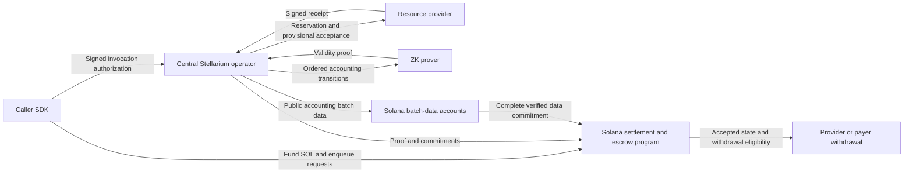

# Stellarium ZK Rollup Plan

For prerequisites and the beginner build sequence, follow [the implementation guide](implementation-guide.md). This plan includes [detailed implementation recipes](#detailed-implementation-recipes) with concrete schemas, code, commands, algorithms, and checkpoints for each subsystem. The [worked code examples](#worked-code-examples) show signature verification, Rust state changes, transactional persistence, dispatch, Merkle paths, chunk commitments, Anchor deposits, and deadline checks.

## Objective and scope

Build an application-specific payment rollup that settles directly to Solana. Stellarium orders resource invocation authorizations, reservations, receipts, refunds, and withdrawals off-chain. A validity proof establishes that each batch applied the accounting rules correctly. Solana verifies that proof before accepting a new state or allowing withdrawal of the resulting earnings.

Stellarium operates a centralized sequencer and batch publisher. The operator posts accounting data, proofs, and settlement transactions to Solana; there is no validator committee or network vote approving payments. Centralization affects ordering, admission, censorship, and availability. It does not give the operator authority to release escrow without the required validity proof.

“Contributing back to Solana” means publishing reconstructible accounting data and verified commitments, keeping settlement collateral on Solana, and paying Solana transaction fees. It does not imply improving Solana consensus or committing Solana to support Stellarium. An intermediate L3 is not part of this design.

Provider API correctness and delivery remain explicit trust assumptions. The proof verifies payment authorization and accounting, not arbitrary API execution. This is a proposed architecture and staged implementation plan, not a claim of deployed or production-ready infrastructure.x

Payment participation is selected per resource function. A function without a `PaymentManifest` executes directly between caller and provider, without escrow, vouchers, reservations, payment receipts, accounting proofs, or settlement. All-free scripts need no rollup payment setup; mixed scripts account only for paid invocations. The provider's registered declaration is authoritative: omitting a voucher or client-side metadata cannot bypass payment for a paid function. A formerly free function that now declares a manifest rejects unauthorized calls before work and returns its current pricing for caller approval. Free calls retain ordinary API authentication, limits, and execution retry rules.

## Architecture



| Component | Responsibility |
| --------- | -------------- |
| Caller SDK/backend | Discover prices, allocate budgets, sign authorizations, track IDs, and recover results. |
| Provider node | Verify invocation and reservation status, execute API work, persist results, and sign receipts. |
| Central operator | Sequence transitions, publish data and proofs to Solana, give provisional acknowledgments, and maintain an outbox. |
| Prover | Produce proofs for the specified deterministic accounting state machine. |
| Solana program | Authenticate deposits, verify batch proofs/data bindings, advance state, enforce withdrawals and emergency exits. |
| Independent observers | Download published data, reconstruct state, validate accounting, and build withdrawal or emergency-exit evidence. |

Use one centrally operated sequencing service with replicated storage and prover workers. Replicas belong to the same operator and do not form a voting committee. The operator uses a dedicated batch-publishing key and funds Solana publication and proof-verification transactions. Record the authorized publisher in deployment configuration and require its signature for normal batch publication and acceptance, in addition to proof verification. Do not build a general-purpose VM, token, staking network, or custom consensus engine for the initial release.

Publisher-key rotation and disaster recovery must be defined in the deployment authority policy. Rotation cannot change accepted accounting state, verifier rules, or payout recipients, and cannot substitute an operator signature for a proof. Unauthorized parties cannot automatically take over batch production in v1. Users and providers must still have access to the permissionless withdrawal and emergency-exit mechanisms described below.

## Accounting state

Use a commitment to these logical tables, with authenticated state updates and fixed canonical schemas:

- Payer/provider accounts: signing authority, available balance, authorization nonce, and authenticated request index/unspent-allocation aggregate for complete emergency entitlements.
- Requests: payer, request ID, source hash, allocated budget, available amount, reserved amount, spent amount, refunded amount, closed flag, and deadlines.
- Invocations: payer/request/invocation identity, recipient, invocation hash, amount, accepted voucher hash, and status.
- Deposits: monotonically consumed Solana inbox cursor; each funding event is credited once.
- Withdrawals: immutable tickets with unique IDs, authorized recipients, and amounts already debited from L2 balances.

Use u64 lamport quantities with checked sums and decimal-string JSON transport. Request and invocation IDs are 32-byte values. The deduplication key excludes receipt hash: re-signing or changing a receipt never creates another payable invocation.

The asset invariant is:

`credited deposits = available balances + unspent request allocations + unpaid withdrawal tickets + completed L1 withdrawals`

Unspent allocations include reserved amounts. Moving money between those categories never creates assets. Vault storage balances and incidental SOL donations do not create spendable L2 credits. Circuit comparisons and sums must constrain integers explicitly rather than rely on arithmetic modulo a proof-system field.

## User and provider flow

The following flow applies to functions with a payment manifest. Calls to functions without one bypass these payment steps and go directly to their provider.

1. **Deposit.** The payer signs a Solana transaction depositing SOL into program-controlled escrow. The program appends an authenticated funding event to its inbox. The rollup credits the canonical event once after Solana finality. Batching cannot debit unrelated wallets without their authorization.
2. **Open request.** The payer signs an authorization allocating existing L2 funds to one request, binding its source hash, budget, domain, and deadlines. No separate Solana escrow account is required for each request in the target design.
3. **Authorize and reserve invocation.** The caller signs a voucher binding recipient, exact amount, typed invocation hash, request/invocation IDs, nonce, and deadline. The accounting transition moves funds from request availability to a reservation. Duplicate or competing charges cannot reserve the same invocation twice.
4. **Execute.** The provider receives the invocation data off-chain and verifies its hash. It chooses whether to accept provisional sequencer reservation or wait for a proven reservation accepted on Solana. Only the latter protects against a sequencer promising the same funds in conflicting provisional histories. A provisional acknowledgment is not final payment assurance.
5. **Receipt.** After successful work, the provider signs a compact receipt committing to the exact voucher hash. Its transition consumes the reservation once, increases provider balance, and records the invocation as paid. Failed or abandoned work follows a deterministic reservation-expiry rule.
6. **Prove and settle.** The centralized operator publishes accounting data, obtains a batch proof from its prover workers, and posts it to Solana. Acceptance advances the state commitment and makes that batch's accounting final once Solana finalizes the transaction.
7. **Withdraw.** A payer or provider signs an L2 withdrawal request. The transition debits available balance and creates a ticket. After proof acceptance, anyone can relay that ticket and its inclusion proof to Solana; funds go only to its recorded recipient. L1 records its withdrawal ID as claimed before transferring atomically.
8. **Refund.** Once request deadlines have passed and its reservations are resolved, request closure releases remaining unreserved funds to the payer's L2 balance. Reservation expiration releases reserved funds under the signed deadline rules. Refunds become Solana transfers through the same withdrawal path, not unilateral vault withdrawal while off-chain claims remain unsettled.

Providers may aggregate many calls into one withdrawal, but disjoint recipients still require bounded Solana withdrawal transactions. Proof acceptance and cash payout are separate operations.

## Expiry and batch public inputs

Do not trust sequencer wall-clock timestamps. Each proof binds a validity interval `[validFrom, validUntil)`; Solana requires its Clock time to be within it at acceptance. The circuit proves that every transition in the batch is valid throughout that interval: charging/acceptance deadlines must be at least `validUntil`, and expiry-based release deadlines must be no later than `validFrom`. A batch that misses its interval must be rebuilt; success before expiry alone does not justify late settlement.

Separate invocation acceptance cutoff from its receipt-settlement deadline. Signed reservation terms include both and leave a measured allowance for execution, proof generation, data publication, and L1 landing. Only reservation expiry can release its funds, and receipt consumption and release are mutually exclusive state transitions.

Every batch proof binds at least:

- Protocol version, rollup ID, Solana genesis hash, program ID, and verifier version.
- Sequential batch number, previous accepted state commitment, and new commitment.
- Canonical L1 inbox snapshot commitment and consumed cursor range.
- Forced-operation cursor range.
- Published accounting-data commitment and byte length.
- Withdrawal commitment and validity interval.

Use a canonical encoded public-input commitment if needed to reduce verifier input count. Constrain the commitment preimage in the circuit; never reduce arbitrary 32-byte hashes into field elements ambiguously. The selected encoding must have cross-language golden vectors.

## Proof obligations

The circuit must establish all of the following, including across batch boundaries:

- Deposits originate from the program's authenticated inbox and are consumed exactly once, in order.
- Request and invocation signatures match the recorded authorities and complete domain-separated messages.
- Provider receipts match the reserved voucher and recipient; parameters are bound by their off-chain hash.
- Request allocations, reservations, charges, refunds, and withdrawal tickets preserve balances with no underflow or overflow.
- Only permitted invocation state transitions occur; receipt consumption and expiry release cannot both occur.
- Nonces, request/invocation identities, and withdrawal IDs prevent replay, including after local cleanup.
- Withdrawals debit balances before they can be claimed and cannot redirect recipients.
- Published data reconstructs the same ordered accounting transitions and state commitment proven by the circuit.
- Forced operations and relevant time boundaries follow the public acceptance rules.

Knowledge of a Merkle root or a quorum signature is not a substitute for these checks. Verification bugs, underconstrained circuits, setup failures, and program upgrades remain security risks even with ZK proofs.

## Solana settlement program

Prefer one program owning escrow, deposit inbox, accepted state, verifier configuration, batch metadata, and withdrawal claims. Avoid unnecessary cross-program custody boundaries.

| Instruction family | Purpose |
| ------------------ | ------- |
| Initialize deployment | Bind domain, initial state, verifier key/hash, supported proof version, authorized operator publisher, and genesis parameters. |
| Deposit | Require funding signer; transfer actual SOL and record the canonical deposit event. |
| Publish/seal batch data | Require operator authorization; upload bounded chunks into deterministic accounts, verify complete ordered bytes and commitment, then freeze writes. |
| Accept batch | Require authorized operator signature and verify current parent state, inbox anchors, complete data, time interval, public inputs, and validity proof; advance state atomically. |
| Claim withdrawal | Verify ticket inclusion in an accepted commitment and recipient; prevent duplicate withdrawal by ID; transfer atomically. |
| Force operation | Enqueue an authenticated operation with an enforceable processing deadline. |
| Freeze and emergency exit | Stop state advances under specified timeout rules and enable consistent exits from the last accepted state. |

Deposits arriving during proof generation cannot invalidate an earlier authenticated inbox prefix or be credited twice. Store verifiable canonical prefix snapshots for proofs. Only actual accepted program state is authoritative; events and RPC responses alone are not deposit authorization.

There is no per-receipt L1 account in the target design. L1 still needs custody state, inbox/data storage, accepted batch commitments, and withdrawal replay protection. Storage growth is reduced, not eliminated.

## Data availability and recovery

V1 publishes all data necessary to reconstruct accounting state on Solana, including canonical authorizations, signatures, public invocation hashes, receipts, and state-transition information. Actual API parameters, script source, and outputs remain off-chain; their hashes are commitments and do not guarantee privacy against guessing.

Batch data may span multiple upload transactions. Acceptance requires all chunks to be present, correctly ordered, hash-checked, and immutable. Begin the devnet prototype with retained data accounts and independent mirrors. No pruning before a separately reviewed retention/availability design. Budget explicitly for storage, uploading, and provider recovery; archival transaction access alone is not assumed to guarantee availability.

Publishing only roots/proofs while keeping reconstruction data with Stellarium operators would be a validium with an additional availability trust assumption. It is not the selected rollup model. The general distinction is described in the [Ethereum rollup architecture](https://ethereum.org/developers/docs/scaling/zk-rollups/) and [data-availability documentation](https://ethereum.org/developers/docs/data-availability/); those sources describe principles, not an available Solana deployment.

Any party with published state and accepted verifier parameters should be able to reconstruct accounting and build withdrawal or emergency-exit proofs. Normal replacement batches remain restricted to the centrally authorized publisher. If that operator cannot resume, the protocol uses its timeout and escape path rather than assuming permissionless sequencer takeover. Recovery cannot depend on the operator holding unpublished data for already accepted state.

## Censorship and emergency exits

Forced requests enter the L1 inbox with a protocol deadline. Batch proofs must consume the required prefix; they cannot skip overdue requests. If no valid progress occurs within the timeout, anyone can activate escape mode. Designing and testing these rules is a required milestone, not an optional production enhancement.

Escape mode freezes the last accepted state and relevant inbox cursor atomically, rejects later batches, and reconciles three disjoint categories:

- Available/allocated balances in the frozen state, with one exit per authorized balance entitlement.
- Already proven unpaid withdrawal tickets, retaining normal withdrawal-ID replay protection.
- Deposits beyond the consumed cursor, refundable once to their recorded payers.

Reserved funds require an explicit escape rule. The proposed rule refunds reservations to their payer once their settlement deadline has elapsed; receipts not accepted in a proven batch do not become provider earnings. Providers therefore retain outage risk for unfinished settlement. Do not refund before a reservation deadline or count pending withdrawals again as balance exits.

The exact escape proof, liability accounting, nullifiers, deadlines, and interaction with existing claims must be specified and audited before real funds. A valid accounting proof alone does not provide an exit when the operator disappears.

## Proof-system feasibility

Evaluate a purpose-built accounting circuit with a compact proof verified on Solana before choosing an implementation stack. A BN254/Groth16 verifier is a candidate, not a committed production choice: Solana documents BN254 group and pairing syscalls, but complete verifier compatibility, byte encoding, curve checks, compute cost, and target-cluster availability must be demonstrated. See [Solana syscall documentation](https://solana.com/docs/core/programs/syscall-reference).

The first benchmark must include actual payer and provider signature verification inside the proof. Existing Ed25519 wallets simplify client adoption but Ed25519/SHA hashing inside a circuit can dominate proving cost. Do not silently replace signature checks with sequencer assertions. Compare native circuits and a zkVM with a Solana-verifiable proof/wrapping path; recursion is a separate milestone if required.

For Groth16, specify the setup ceremony, contribution verification, circuit/version-specific keys, and toxic-waste trust assumptions. A different proof system has different verifier and setup requirements. Do not promise a batch size, TPS, verification fee, or withdrawal latency before measuring the end-to-end workload.

## Delivery milestones

| Phase | Deliverable | Exit criterion |
| ----- | ----------- | -------------- |
| 1. Reference accounting | Deterministic Rust transition engine, TypeScript caller schemas, durable provider lifecycle | Model tests cover deposits, reservation conflicts, charges, expiry, refunds, and withdrawals. |
| 2. Feasibility spike | Real signature-checking proof and Solana verifier prototype | Valid proofs verify locally; invalid ones fail; measure proof generation, memory, serialized size, compute, and setup requirements. |
| 3. End-to-end devnet | Deposit, reserve, receipt, data publication, batch acceptance, withdrawal | Independent node reconstructs state and verifies conservation and replay protection. |
| 4. Recovery | Forced-operation queue, operator key recovery, prover-worker failover, freeze/escape path | Operator shutdown, withholding, delayed proof, and competing withdrawals cannot create double payouts or unauthorized refunds; users can exit without operator cooperation. |
| 5. Economics and security | Measured batch policy, fee model, capacity limits, independent program/circuit audit | Proving, L1 publication/storage, withdrawals, and recovery costs support realistic call prices; critical findings resolved. |
| 6. Mainnet decision | Published build, keys, domain, custody policy, and accepted risks | Explicit launch approval after the preceding gates; no automatic deployment from this plan. |

Compare one-call and multi-provider scripts against direct Solana settlement using identical workload and recovery requirements. Measure separate provisional acceptance, proof acceptance, Solana finality, and cash-withdrawal latencies. Configure batch limits by observed proof/data costs and maximum wait, with smaller batches when traffic is low.

The prototype is upgradeable on devnet. Before mainnet, decide and document immutable deployment versus delayed governance upgrades, including publisher-key rotation/recovery, verifier changes, and exit time for existing users. An operator or administrator signature never replaces a valid proof. No validator committee is part of this architecture. No platform fee or native token is assumed; introducing either requires signed fee terms and updated conservation rules.

## Repository migration

The current node forwards generated scripts to remote `/v1/run`. Introduce a caller-side interpreter/invoker that issues typed calls and vouchers, a provider invocation and authenticated result-recovery API, and sequencer submission/status APIs. Guard every route capable of invoking paid functions. Store invocation IDs, accepted authorizations, results, receipts, and outbox transitions durably across replicas.

Add a separate Rust accounting/verifier implementation and proof workspace after the feasibility phase chooses a stack. Do not embed consensus-critical arithmetic in loosely validated JSON handlers. The existing monetization guide supplies API context, but its direct per-receipt settlement flow is superseded by this proposed rollup architecture.

## Detailed implementation recipes

Work through these recipes in order alongside the [beginner guide](implementation-guide.md). Each recipe specifies what to create, how to implement it, and how to establish that it works. Paths below are relative to this repository. `crates/accounting/` and `solana/` already contain learning scaffolds; reuse them. The payment modules, circuit and settlement handlers described below are additions to build, not existing implementations. Keep encoders in the current node's `src/payment/` initially; move them to the beginner guide's proposed `packages/payment-sdk/` only when package workspace imports are configured, rather than maintaining two implementations. Commands are for you to run locally after installing the prerequisites in the beginner guide. Keep the first complete flow on a local Solana network, then repeat it on devnet.

Use these checkpoints to navigate the build:

| Build area | Recipes |
| --- | --- |
| Protocol and accounting | [Scaffolds](#1-create-the-implementation-boundaries-and-fixtures), [u64 helpers](#2-implement-u64-amounts-at-every-boundary), [signed bytes](#3-define-and-sign-exact-bytes), [transitions](#4-implement-the-reference-state-machine-before-proving-it). |
| Persistence and proofs | [Durable execution](#5-make-deduplication-and-provider-execution-durable), [commitments](#6-commit-state-and-batch-bytes-deterministically), [circuit constraints](#7-turn-integer-rules-into-proof-constraints). |
| Solana settlement | [Custody/deposits](#8-build-solana-custody-and-authenticated-deposits), [publication/acceptance](#9-publish-data-then-accept-a-proof-atomically), [withdrawals](#10-redeem-withdrawal-tickets-without-double-accounting). |
| Recovery and integration | [Forced operations/escape](#11-implement-forced-operations-and-escape-as-a-separate-tested-protocol), [complete node flow](#12-wire-the-existing-node-and-operate-one-complete-flow). |

### 1. Create the implementation boundaries and fixtures

1. Create `src/payment/` for transport validation and canonical signing bytes; `src/rollup/` for operator orchestration; `tests/payment/` for TypeScript tests; and `fixtures/payment/` for shared test vectors. Use `mkdir -p src/payment src/rollup tests/payment fixtures/payment circuits/spikes proof-artifacts` from the repository root.
2. Use the existing `crates/accounting/` reference crate. If starting from a checkout without it, run `cargo new --lib crates/accounting` once. Its generated `add(left, right)` uses unchecked addition; replace that learning example with the checked helpers below. Run it with `cargo test --manifest-path crates/accounting/Cargo.toml`; it does not need to be deployed to Solana.
3. Keep the reference crate independent of RPC, SQLite, HTTP, and system time. Its public interface should take an old state, one decoded transition, and an explicit validity interval, and return either a new state plus effects or a typed error. Effects describe facts such as `WithdrawalCreated`; the function itself sends no transaction.
4. Create `docs/protocol-v1.md` before writing a prover. List every record's field order, byte width, integer encoding, signature domain, status values, and maximum collection length. Keep this as the authoritative schema; fixtures are examples of it. Assign permanent transition tags: deposit `1`, open request `2`, reserve `3`, receipt `4`, release reservation `5`, close request `6`, withdrawal `7`. Never reuse a tag when upgrading the schema.
5. Create fixtures for one payer, two providers, and a script with two paid calls and one free call. Use local test keys only. Store public keys, public messages, signatures, and expected roots in fixtures; exclude private keys, wallet files, database files, and build outputs from Git.
6. Record tool versions with `node --version`, `pnpm --version`, `rustc --version`, `cargo --version`, `solana --version`, and `anchor --version`. Pin the selected versions in the project and CI after a successful local build. A proof-stack choice comes later; do not add a placeholder verifier that returns success.

**Checkpoint:** a test can load the same fixture in TypeScript and Rust without contacting a service. The manifest-free call produces no payment transition.

### 2. Implement u64 amounts at every boundary

A lamport amount is an integer in `[0, 18446744073709551615]`. JavaScript `number` cannot represent every value in that range. Receive decimal strings in JSON, validate them, calculate using `bigint`, and convert back to strings only when returning JSON. One SOL is `1000000000` lamports; never multiply a floating-point SOL value and round it to produce an authorization.

Create `src/payment/u64.ts` with this complete helper module:

```ts
export const U64_MAX = (1n << 64n) - 1n;

export function parseU64(value: unknown): bigint {
  // Check length before regex/BigInt to bound work on hostile input.
  if (typeof value !== 'string' || value.length === 0 || value.length > 20) {
    throw new Error('Expected a decimal u64 string');
  }
  // One representation per value: no sign, whitespace, exponent or leading zero.
  if (/[^0-9]/.test(value) || (value.length > 1 && value[0] === '0')) {
    throw new Error('Noncanonical decimal amount');
  }
  const amount = BigInt(value);
  if (amount > U64_MAX) throw new Error('u64 overflow');
  return amount;
}

export function requireU64(value: bigint): bigint {
  if (typeof value !== 'bigint' || value < 0n || value > U64_MAX) {
    throw new Error('Value outside u64');
  }
  return value;
}

export function addU64(a: bigint, b: bigint): bigint {
  requireU64(a);
  requireU64(b);
  return requireU64(a + b);
}

export function subU64(a: bigint, b: bigint): bigint {
  requireU64(a);
  requireU64(b);
  return requireU64(a - b);
}

export function encodeU64LE(value: bigint): Buffer {
  const bytes = Buffer.alloc(8);
  bytes.writeBigUInt64LE(requireU64(value));
  return bytes;
}
```

Then execute these substeps:

1. At HTTP ingress, pass the actual untrusted value to `parseU64`; do not call `String(value)` first, which would admit numeric JSON and already-rounded values. Return a validation error before reserving funds or executing work.
2. After parsing, separately enforce operation rules: deposits, paid vouchers, and withdrawals require `amount > 0n`. Zero is valid for balances and counters. Nonces, deposit IDs, and batch numbers also need checked increments; reject exhaustion rather than wrap.
3. Use `addU64` and `subU64` for every balance mutation. Do not use `BigInt.asUintN(64, ...)`: it wraps invalid values into apparently valid balances.
4. Serialize individual JSON amount fields with `amount.toString()`. Do not globally convert all large integers to numbers or use a serializer that silently changes the wire schema.
5. For pricing involving multiplication, use `bigint` operands, check the product against `U64_MAX`, then apply the explicitly signed rounding rule if division is required. Prefer an exact fixed lamport price per invocation in v1.
6. Enforce HTTP body limits before parsing, and collection-count limits before iterating. A short amount field alone does not bound an entire batch.

Create `tests/payment/u64.test.ts`:

```ts
import { describe, expect, it } from 'vitest';
import { U64_MAX, parseU64, addU64, subU64, encodeU64LE }
  from '../../src/payment/u64.js';

describe('payment u64', () => {
  it('preserves exact values and fixed-width bytes', () => {
    expect(parseU64('0')).toBe(0n);
    expect(parseU64('9007199254740993')).toBe(9007199254740993n);
    expect(parseU64(U64_MAX.toString())).toBe(U64_MAX);
    expect(encodeU64LE(1n).toString('hex')).toBe('0100000000000000');
    expect(encodeU64LE(U64_MAX).toString('hex')).toBe('ffffffffffffffff');
  });
  it('rejects malformed and out-of-range inputs', () => {
    for (const input of [1, null, '', '-1', '+1', '01', ' 1', '1.0',
      '1e3', '1\n', '1\r', '１２', '18446744073709551616', '1'.repeat(1000)]) {
      expect(() => parseU64(input)).toThrow();
    }
  });
  it('rejects overflow and underflow', () => {
    expect(addU64(U64_MAX - 1n, 1n)).toBe(U64_MAX);
    expect(subU64(1n, 1n)).toBe(0n);
    expect(() => addU64(U64_MAX, 1n)).toThrow();
    expect(() => subU64(0n, 1n)).toThrow();
    expect(() => addU64(-1n, 1n)).toThrow();
  });
});
```

Run `pnpm exec vitest run tests/payment/u64.test.ts`. These tests exercise the actual boundary failures, rather than only checking a normal-sized payment.

In `crates/accounting/src/amount.rs`, use Rust's checked operations:

```rust
#[derive(Debug, PartialEq, Eq)]
pub enum AmountError { Overflow, Underflow }

pub fn add(a: u64, b: u64) -> Result<u64, AmountError> {
    a.checked_add(b).ok_or(AmountError::Overflow)
}

pub fn sub(a: u64, b: u64) -> Result<u64, AmountError> {
    a.checked_sub(b).ok_or(AmountError::Underflow)
}
```

Add `pub mod amount;` to the crate's `lib.rs`, write matching boundary tests, and run `cargo test --manifest-path crates/accounting/Cargo.toml`. `checked_add`/`checked_sub` report failure rather than wrap; see the [Rust u64 reference](https://doc.rust-lang.org/std/primitive.u64.html). Decode wire amounts from exactly eight bytes with `u64::from_le_bytes`; reject truncated or trailing message bytes. If parsing decimal JSON in Rust, enforce the same length/digit/leading-zero rules before `parse::<u64>()`.

For conservation across many accounts, accumulate with checked `u128` additions in Rust, or unbounded `bigint` in TypeScript. Individual records are u64; the sum of several records may exceed u64. In the circuit, specify a bounded accumulator width that covers the protocol's maximum total supply/liability and prove that bound too.

**Checkpoint:** both languages accept the same fixture amounts and produce the same eight bytes. A rejected transition leaves the entire old state unchanged.

### 3. Define and sign exact bytes

Do not sign arbitrary `JSON.stringify` output for consensus-critical payments. This repository's general-purpose signing utility currently does that; introduce a dedicated payment encoder rather than changing every existing API signature implicitly.

1. Create `src/payment/encoding.ts` and `crates/accounting/src/encoding.rs`. Define a deployment domain as `SHA256(ASCII("STELLARIUM:DOMAIN:1") || protocolVersionU32LE || rollupId32 || genesisHash32 || programId32 || verifierVersionU32LE)`. All listed fields are fixed width; versions are four-byte unsigned little-endian integers. Specify each width in `protocol-v1.md`; public keys and hashes are decoded raw bytes, not their printed base58/hex strings.
2. Use a fixed voucher layout, for example the table below. This is a proposed v1 schema: implement and freeze it before client and circuit development. `u64LE` means eight unsigned little-endian bytes.

| Field, in order | Bytes | Validation |
| --- | ---: | --- |
| Message tag `STELLARIUM:VOUCHER:1` | 20 | Exact ASCII bytes; other message types have different tags. |
| Deployment domain | 32 | Must equal initialized deployment. |
| Payer authority | 32 | Raw Ed25519 public key. |
| Provider receipt authority | 32 | Registered key, bound to accepted price terms. |
| Provider earnings account ID | 32 | Immutable recipient of the charge. |
| Request ID | 32 | Fixed bytes; scoped by deployment and payer. |
| Invocation ID | 32 | Fixed bytes; unique within that request. |
| Typed invocation hash | 32 | Includes resource/function identity and canonical argument bytes. |
| Payment manifest hash | 32 | Binds exact price, asset, recipient and version. |
| Amount | 8 | Positive u64 lamports; SOL-only v1. |
| Authorization nonce | 8 | Expected next payer nonce. |
| Accept-before timestamp | 8 | Unsigned Unix seconds. |
| Settle-before timestamp | 8 | Unsigned Unix seconds, strictly later than acceptance cutoff. |

3. Write encoders that reject every wrong-width field, then concatenate in table order with `Buffer.concat` in TypeScript and a byte vector in Rust. The resulting voucher has exactly `20 + 8 * 32 + 4 * 8 = 308` bytes. Assert that length in tests. A decoder must consume exactly 308 bytes and reject extra bytes.
4. Encode typed arguments separately. For strings, use a fixed u32 byte-length prefix plus UTF-8 bytes; for arrays, a bounded count and individually typed elements; for integers, a declared width. Distinguish missing, null, empty string, and empty array. Resolve object field order through the function's declared schema, rather than object iteration order. Publish vectors for nested arguments and Unicode. Hash these canonical bytes with a separate invocation tag.
5. Generate request/invocation IDs using `crypto.randomBytes(32)` and persist them before any HTTP attempt. A retry reuses the same invocation ID and byte-identical voucher. A new payable execution needs a new invocation ID and authorization. Never derive deduplication identity from a signature or receipt hash.
6. Sign the exact voucher bytes with the caller wallet's message-signing interface. For a Node test using an Ed25519 `KeyObject`, `sign(null, voucherBytes, privateKey)` and `verify(null, voucherBytes, publicKey, signature)` operate on those bytes. Wallet signatures are 64 raw bytes. Public wire encodings must be decoded with a canonical round-trip check and exact width validation.
7. Define a provider receipt message as its own tag plus deployment domain, full voucher hash, invocation outcome/status, and optional output hash. Only the specified success status can charge; the circuit verifies the provider signature and that its key matches the voucher. A public output hash does not give someone access to private result data.
8. Give open-request, withdrawal, and result-recovery messages their own tags and complete schemas. Open-request binds payer, request ID, source hash, budget, nonce, deadlines and domain. Withdrawal binds source account, unique ticket ID, recipient, amount, nonce and domain. For private result recovery, sign a provider-issued short-lived challenge binding operation, invocation, payer, provider, challenge nonce and expiry; consume it once. Do not accept a public voucher as result-access authentication.
9. Save golden vectors containing message hex, hash, public key, signature, and decoded fields. Check them in TypeScript, Rust, and the selected circuit. Flip one bit in the domain, recipient, amount, each deadline, and invocation ID; every altered message must fail signature verification.

Use this encoder after validating the HTTP object. It rejects wrong widths and enforces the schema's amount/deadline relationships; signature verification and current-state checks still happen separately. Save it in `src/payment/encoding.ts`:

```ts
import { encodeU64LE, requireU64 } from './u64.js';

export type VoucherFields = {
  domain: Uint8Array;
  payer: Uint8Array;
  receiptAuthority: Uint8Array;
  earningsAccount: Uint8Array;
  requestId: Uint8Array;
  invocationId: Uint8Array;
  invocationHash: Uint8Array;
  manifestHash: Uint8Array;
  amount: bigint;
  nonce: bigint;
  acceptBefore: bigint;
  settleBefore: bigint;
};

function fixed32(value: Uint8Array): Buffer {
  if (!(value instanceof Uint8Array) || value.byteLength !== 32) {
    throw new Error('Expected exactly 32 bytes');
  }
  return Buffer.from(value);
}

export function encodeVoucher(v: VoucherFields): Buffer {
  requireU64(v.amount);
  requireU64(v.acceptBefore);
  requireU64(v.settleBefore);
  if (v.amount === 0n || v.acceptBefore >= v.settleBefore) {
    throw new Error('Invalid amount or deadlines');
  }
  const bytes = Buffer.concat([
    Buffer.from('STELLARIUM:VOUCHER:1', 'ascii'),
    ...[v.domain, v.payer, v.receiptAuthority, v.earningsAccount,
      v.requestId, v.invocationId, v.invocationHash, v.manifestHash]
      .map(fixed32),
    ...[v.amount, v.nonce, v.acceptBefore, v.settleBefore].map(encodeU64LE),
  ]);
  if (bytes.length !== 308) throw new Error('Voucher schema mismatch');
  return bytes;
}
```

Test that each 32-byte field lands at its documented offset, that `amount` begins at byte 276, and that the four u64 values decode identically in Rust. Hash using `createHash('sha256').update(voucherBytes).digest()` from `node:crypto`. Signing uses the full bytes; the receipt references their hash. Do not accidentally sign the displayed hexadecimal text.

**Checkpoint:** encoders produce identical bytes; independent verifiers accept the original and reject altered messages. The proof's signature gadget uses this same message, not a narrower surrogate.

### 4. Implement the reference state machine before proving it

Create `crates/accounting/src/state.rs` for records and `transition.rs` for transitions. For v1, key each balance account by its signing-authority public key and permit one balance account per authority; the voucher earnings account is that withdrawal authority's public key. Delegated receipt-signing keys are separate and must be bound by the accepted manifest. Use enums for invocation states (`Reserved`, `Paid`, `Released`) and exhaustive Rust matches. Store immutable identity and voucher fields alongside status. An absent invocation is different from an existing terminal invocation.

Implement each transition as the following ordered checks and mutations:

| Transition | Checks before mutation | Atomic result |
| --- | --- | --- |
| Deposit | Authenticated inbox membership, exact next cursor, positive amount, correct deployment/payer. | Credit payer available balance; advance cursor once. |
| Open request | Valid payer signature/nonce; request absent; sufficient available balance; signed deadlines valid. | Debit account; create allocation; increment nonce. |
| Reserve | Request belongs to payer; valid complete voucher and nonce; invocation absent; price/recipient permitted; acceptance and settlement cutoffs cover batch interval; sufficient request availability. | Decrease request available; increase reserved; create `Reserved` invocation; increment nonce. |
| Receipt | Invocation is `Reserved`; exact voucher hash/amount/recipient; valid provider success signature; settlement deadline covers interval. | Decrease reserved; increase spent and provider balance; set `Paid`. |
| Release reservation | Invocation is `Reserved`; settlement deadline is at or before `validFrom`. | Decrease reserved; increase request available; set `Released`. |
| Close request | Request cutoff is at or before `validFrom`; no remaining reservations; request not already closed. | Return its available amount to payer; set available to zero and mark closed. |
| Withdrawal | Valid account signature/nonce; ticket ID absent; positive amount; sufficient available balance. | Debit account; insert immutable ticket; increment nonce. |

For a request, enforce `allocated = available + reserved + spent + refunded`. Add `refunded` and a `closed` flag to its schema so closing a request does not destroy its reconciliation history. The asset invariant counts only `available + reserved` as an unspent allocation; `spent` is already reflected in provider earnings, and `refunded` is already reflected in the payer account.

To implement `Reserve` specifically:

1. Load the payer account and request using full namespace keys. Verify ownership before reading its funds as the voucher's budget.
2. Check absence of `(domain, payer, requestId, invocationId)`. If it exists with identical authorization, return the existing outcome without applying another transition; if its authorization differs, return a conflict.
3. Verify domain, signature, expected nonce, manifest binding, amount and deadlines. Compare the interval endpoints supplied to the transition engine, not server time.
4. Calculate `nextAvailable = sub(oldAvailable, amount)`, `nextReserved = add(oldReserved, amount)`, and `nextNonce = add(oldNonce, 1)`. If any calculation fails, return without writing anything.
5. Stage all changes in a new state or write set. Insert the invocation only after all checks succeed; commit the complete write set as one operation. Avoid mutating a shared map and then discovering an error halfway through.
6. Recompute the request reconciliation and global conservation checks in tests after every successful transition.

Use a concrete fixture: deposit `1000`, allocate `600`, reserve `200` for provider A and `300` for provider B. Payer available is `400`, request available `100`, reserved `500`. After A's receipt and B's expiry release, A has `200`, request available `400`, reserved `0`, spent `200`. Closing returns `400`, leaving payer `800`, A `200`. Withdrawing A's `200` leaves payer `800` and a `200` ticket. The free invocation changes no payment state.

Write tests for both orderings of competing reservations, receipt versus release at the deadline boundary, duplicate deposit, duplicate ticket, changed receipt, wrong payer/provider, exhausted nonce, and rollback after the last arithmetic check fails. Use generated transition sequences to check conservation, but also keep these hand-calculated fixtures.

**Checkpoint:** replaying an ordered transition log from genesis produces a byte-identical final state. No test needs a blockchain or prover yet.

### 5. Make deduplication and provider execution durable

Use the existing SQLite integration for a single-process prototype. Add a migration such as `src/payment/migrations/001-invocations.sql`; do not depend on an in-memory cache to remember paid invocations.

```sql
CREATE TABLE payment_invocations (
  domain BLOB NOT NULL CHECK(length(domain) = 32),
  payer BLOB NOT NULL CHECK(length(payer) = 32),
  request_id BLOB NOT NULL CHECK(length(request_id) = 32),
  invocation_id BLOB NOT NULL CHECK(length(invocation_id) = 32),
  voucher_hash BLOB NOT NULL CHECK(length(voucher_hash) = 32),
  voucher_bytes BLOB NOT NULL,
  amount_decimal TEXT NOT NULL,
  status TEXT NOT NULL CHECK(status IN
    ('authorized', 'reserved', 'executing', 'result_saved',
     'receipt_queued', 'proven', 'released', 'execution_unknown')),
  result_ref TEXT,
  receipt_bytes BLOB,
  PRIMARY KEY (domain, payer, request_id, invocation_id)
) WITHOUT ROWID;

CREATE TABLE payment_outbox (
  event_id BLOB PRIMARY KEY NOT NULL CHECK(length(event_id) = 32),
  payload BLOB NOT NULL,
  status TEXT NOT NULL CHECK(status IN ('pending', 'delivered'))
);
```

1. Validate amount strings in the application before insertion. SQLite's ordinary integer representation cannot store the entire unsigned u64 range; keep these values as canonical text and perform arithmetic in validated application code. Never compare decimal text lexicographically or use SQLite casts for balance arithmetic.
2. Start `BEGIN IMMEDIATE` on a dedicated transaction connection; load the current request/account and invocation record, run the reference transition, and write all resulting rows plus its outbox event. Execute `COMMIT` only after every write succeeds; otherwise `ROLLBACK`. Serialize transaction ownership so unrelated async handlers cannot join the same connection's transaction. SQLite permits one writer at a time; handle `SQLITE_BUSY` with bounded retries of the entire transaction, as explained in its [transaction documentation](https://www.sqlite.org/lang_transaction.html).
3. On a uniqueness conflict, retrieve the existing row. Compare canonical voucher bytes or their hash. Identical authorization returns its durable status; different authorization returns a conflict. Do not use `INSERT OR REPLACE`, which could discard a terminal record.
4. Acquire execution using a conditional update from `reserved` to `executing`, checking that exactly one row changed. Call the external API after committing that ownership change, not while holding a database write transaction.
5. Persist output or a durable result reference before creating the receipt. In one transaction, set `result_saved`, store the signed receipt, and append the outbox event that submits it to the sequencer. If using external object storage, write and verify the immutable object first; then commit its reference.
6. An outbox worker submits the same receipt/event ID until an idempotent sequencer acknowledgment arrives. Mark delivered afterward. A crash between submission and marking delivered causes a safe retry.
7. If the process crashes after an external side effect but before saving a result, mark `execution_unknown`; use the upstream API's idempotency key or reconciliation API to recover. A payment ID alone cannot guarantee exactly-once execution of an arbitrary external API. Do not blindly repeat a side-effecting call.
8. Keep terminal invocation identities or a durable authenticated tombstone through archival. Removing result bytes does not remove payment replay protection.
9. For replicas, migrate to one transactionally consistent shared database or explicitly coordinated single writer. Do not run independently writable SQLite copies and treat their local locks as network-wide deduplication.

**Checkpoint:** kill the provider after reservation, during execution, after result save, and after receipt submission. Restarting never creates a second payable invocation, and uncertain execution is visible instead of silently repeated.

### 6. Commit state and batch bytes deterministically

1. Implement a reference authenticated map in `crates/accounting/src/merkle.rs`. Start with a full 256-bit sparse Merkle key, derived as `SHA256(tableTag || deploymentDomain || fullLogicalIdentity)`. Use different table tags for accounts, requests, invocations and tickets. Do not truncate IDs into a small tree without a collision-handling design.
2. Define an empty leaf constant and leaf hash `SHA256(leafTag || key || canonicalRecordBytes)`. Define branch hashes `SHA256(branchTag || left32 || right32)`. Document path bit order; for example, start at the most significant key bit at the root. Publish default empty hashes for all levels and a one-leaf vector.
3. Verify membership by hashing the record into a leaf and walking its 256 siblings from leaf to root. With the root using the most significant bit, the first leaf-level step uses the least significant bit and the final step uses the most significant bit. At each level, that key bit determines whether the current hash is left or right. Nonmembership requires the canonical empty leaf at that key. For an update, the same path must reconstruct the old root, then reconstruct the new root with the changed leaf. Never accept a caller-supplied old value without proving its membership.
4. Apply multiple updates sequentially: update two starts from update one's root. Reusing independent paths from the batch's initial root can discard earlier writes. For composite transitions, define a fixed order for account/request/invocation/ticket updates and replay it identically in Rust and the circuit.
5. SHA-256 is a transparent reference choice, not a promise that a 256-level SHA tree is cheap to prove. Benchmark it. If changing to a circuit-friendly hash or another tree, version the schema and regenerate all vectors before freezing the production circuit; do not change it only in the prover.
6. Encode a batch header plus a bounded transition count and length-prefixed canonical transition records. Include signatures and all state reconstruction data. Do not publish only Merkle paths and omit the authorizations they authenticate. Define whether paths are derivable or included, and enforce identical encoding across observer and prover.
7. An observer downloads batches from genesis, checks their sequence and data commitments, decodes every record, verifies signatures, applies the reference engine, and compares its root with each Solana-accepted root. Save checkpoints with the corresponding accepted batch number and root; a checkpoint is an optimization, not authority.

**Checkpoint:** build two independent maps by inserting the same final records in different orders; their roots match. Mutated record bytes, a reversed path bit, wrong sibling, skipped transition, or reordered conflicting transitions fail the appropriate verification.

### 7. Turn integer rules into proof constraints

TypeScript validation and Rust checks protect honest software. The circuit must separately reject a malicious prover that ignores those checks.

For a Circom feasibility exercise, the following self-contained circuit makes the missing constraints concrete. It is an arithmetic exercise, not the payment circuit or a selected production stack. Save it as `circuits/spikes/checked-add.circom` after selecting a compatible Circom compiler:

```circom
pragma circom 2.1.6;

template U64() {
    signal input value;
    signal bits[64];
    var sum = 0;
    var weight = 1;
    for (var i = 0; i < 64; i++) {
        bits[i] <-- (value >> i) & 1;
        bits[i] * (bits[i] - 1) === 0;
        sum += bits[i] * weight;
        weight *= 2;
    }
    value === sum;
}

template CheckedAdd() {
    signal input a;
    signal input b;
    signal output out;
    component aRange = U64();
    component bRange = U64();
    component outRange = U64();
    aRange.value <== a;
    bRange.value <== b;
    out <== a + b;
    outRange.value <== out;
}

component main {public [a, b]} = CheckedAdd();
```

Execute and extend it as follows:

1. Create the output directory with `mkdir -p proof-artifacts/checked-add`. Compile with `circom circuits/spikes/checked-add.circom --r1cs --wasm --sym --inspect -o proof-artifacts/checked-add`. Inspect compiler warnings and count constraints; compilation is not a security review.
2. Create `proof-artifacts/checked-add/add-valid.json` containing `{"a":"18446744073709551614","b":"1"}`. Run `node proof-artifacts/checked-add/checked-add_js/generate_witness.js proof-artifacts/checked-add/checked-add_js/checked-add.wasm proof-artifacts/checked-add/add-valid.json proof-artifacts/checked-add/add-valid.wtns`.
3. Create invalid fixtures with `a = U64_MAX, b = 1`, and `a = 18446744073709551616, b = 0`. Witness generation should fail. In the eventual proof harness, independently verify that invalid assignments cannot satisfy the R1CS; a witness generator rejecting input does not by itself prove sound constraints.
4. Explain each constraint in review: the boolean equation restricts every bit to 0 or 1; the weighted equality binds all 64 bits to the value; constraining `out` too rejects overflow. The selected field must be larger than the possible integer expressions, here at least greater than `2^65`. These small bounded sums then cannot exploit field wraparound.
5. Implement subtraction with the same range checks and `out <== a - b`. When `a < b`, its field result cannot fit the output's 64 bits. Test `0 - 1` rejection and `1 - 1 = 0` acceptance.
6. For a comparison such as `amount <= available`, either use the range-checked subtraction witness `remaining = available - amount`, or a reviewed comparator gadget with both operands constrained to 64 bits. For multi-term sums, constrain intermediate values and their maximum widths; do not assume the two-input proof applies to unbounded accumulation.
7. In Circom, `<--` supplies a witness value without an equality constraint. The example adds explicit boolean and reconstruction constraints for every such value. Use `<==` when assignment and equality should coincide. Host-language assertions cannot replace circuit constraints; see [Circom constraint generation](https://docs.circom.io/circom-language/constraint-generation/).
8. Apply the same reasoning to statuses, path direction bits, transition selectors and lengths. Prove selectors are boolean, exactly one transition type is active, and inactive padded slots cannot change state. Prove selected hashes/signatures belong to the selected transition, rather than leaving them as disconnected inputs.
9. Encode each 32-byte hash as two fixed 128-bit limbs, constrain both limbs, and fix byte order. This preserves all 256 bits. Never use `hash mod fieldPrime`, which would admit ambiguous encodings.

For the **real feasibility spike**, build one full `Reserve + Receipt` proof with actual payer and provider Ed25519 signatures, canonical SHA-256 message commitments, authenticated old/new state paths, integer rules, nonces, deadlines and batch-data binding. Do not use Circom's BabyJubJub EdDSA gadget as if it verified Solana Ed25519 wallet signatures; they are different schemes. Identify an applicable reviewed Ed25519 implementation or a zkVM execution path and test its malformed-signature/point handling. If no suitable implementation or affordable Solana-verifiable wrapper exists, record that feasibility failure before building the whole service.

Use the selected stack's documented setup/proving workflow, saving circuit source hash, compiler version, parameters, verifying key, proof bytes and public inputs. For a Groth16 experiment, follow the [snarkjs maintainers' setup and proof tutorial](https://github.com/iden3/snarkjs); a local developer-only ceremony is a learning artifact, not production setup. Make the Solana verifier pass those exact bytes and reject one-bit mutations before choosing the stack.

**Checkpoint:** the spike measures proving time, peak RAM, proof length, public-input encoding, Solana simulation compute, and data upload size on the actual two-signature workload. A trivial addition proof cannot clear this gate.

### 8. Build Solana custody and authenticated deposits

After the local counter/escrow exercises in the beginner guide, reuse the existing `solana/` Anchor workspace. Its program entry point is `solana/programs/solana/src/lib.rs`, with state in `src/state.rs` and handlers under `src/instructions/`; these paths are relative to that program directory. The current `initialize`/`increment` counter is a scaffold, not custody logic. If starting from a checkout without the workspace, run `anchor init solana` from the repository root once. Inspect `solana/Anchor.toml`, the generated layout and test template because scaffolding depends on the installed Anchor release. From `solana/`, run `anchor build` and the configured test command before adding rollup logic. This checkout currently configures `cargo test` with `skip_local_validator = true`; retain fast program tests and explicitly start the local network described in the beginner guide for RPC integration tests.

A Solana **account** is persistent program state; a **PDA** is a deterministic address derived from seeds and a program ID. The program can own a PDA without an operator private key controlling its SOL. Use the following account design initially:

| Account | PDA seed components, in order | Contents |
| --- | --- | --- |
| Config | `"config"`, rollup ID | Domain, publisher, verifier hash/version, limits, timeouts, frozen flag. |
| Vault | `"vault"`, config address | Program-owned SOL custody; recorded storage reserve and liability counters. |
| Inbox | `"inbox"`, config address | Next deposit ID and current authenticated prefix commitment. |
| Deposit event | `"deposit"`, config address, deposit ID u64LE | Payer, positive amount, ID, immutable prefix commitment. |
| Batch data | `"batch"`, config address, batch number u64LE | Parent, chunk count/length, running commitment, sealed/accepted flags. |
| Batch chunk | `"chunk"`, batch-data address, chunk index u32LE | Immutable accounting bytes. |
| Accepted batch | `"accepted"`, config address, batch number u64LE | Accepted state/withdrawal roots, inbox cursors, public-input commitment. |
| Claim | `"claim"`, config address, withdrawal ID | Permanent withdrawal replay marker. |

1. Declare fixed-size Anchor state structs with `#[account]` and `#[derive(InitSpace)]`. For ordinary structs using default discriminators, allocate `8 + Type::INIT_SPACE`; a `u64` is eight bytes, a public key 32 bytes. For vectors, specify a bounded maximum length and allocate for that bound; do not use in-memory `size_of` as serialized size. See [Anchor account space](https://www.anchor-lang.com/docs/references/space).
2. In every instruction's `Accounts` context, validate account owner/type, PDA seeds and bump, required signers, and relationships to config. A publishing instruction needs a `Signer` whose key equals `config.publisher`. These are executable constraints, not comments on unchecked accounts; use [Anchor account constraints](https://www.anchor-lang.com/docs/references/account-constraints).
3. Limit initialization to the deployment's designated bootstrap authority, and create each config once. An arbitrary first caller must not be able to choose the publisher or verifier. Initialization validates the specified genesis empty root and full domain rather than trusting arbitrary root input.
4. Implement `deposit(amount)` with a funding signer, the correctly derived writable vault/inbox, and a new event account at the next ID. Calculate all checked next counters and liability values before transferring. Transfer exactly `amount` from the payer with the System Program; write the event and advance the inbox in the same transaction. Repeated use of the same event ID fails account creation.
5. Define `depositPrefix[i] = SHA256(depositTag || depositPrefix[i-1] || canonicalDeposit[i])`, with a specified genesis prefix. Store the new prefix on the immutable event and inbox. A proof consuming through ID `i` binds that stored prefix, while later deposits can extend the inbox without invalidating it.
6. The operator reads program-owned deposit accounts at finalized commitment, validates owner/PDA/config and continuity, and feeds the exact records to the proof. Log messages and notifications may trigger fetching but are never the source of deposit authority.
7. Separate the vault's minimum storage balance from deposit principal. Track credited liabilities explicitly. A direct SOL donation to the vault changes its actual lamports but creates no deposit event and no L2 credit. Check liability growth and actual transfer capacity with checked arithmetic.
8. When paying out of this **program-owned** vault, debit its lamports directly under the runtime's ownership rules and credit the recipient; do not try a System Program transfer from a data-bearing program-owned account. Preserve its storage minimum. Solana permits only the owning program to debit that account, as described in [account modification rules](https://solana.com/docs/core/accounts/modification-rules).
9. Test unsigned funding, wrong vault/config, substituted inbox, duplicate deposit ID, donated SOL, zero amount, and counter overflow. Also prefund a not-yet-created deposit/claim PDA with a small System Program transfer and verify your initialization strategy cannot be permanently blocked or bypass ownership checks by that prefunding. Confirm failures roll back both money and event creation. Then consume a prefix, append a later deposit, and prove the earlier prefix remains usable.

**Checkpoint:** a deposit cannot create more L2 credit than its recorded funded amount, and replay cannot consume it twice. No general operator withdrawal instruction exists.

### 9. Publish data, then accept a proof atomically

Implement three distinct instruction handlers: `begin_batch`, `append_chunk`, and `seal_batch`, followed by `accept_batch`. Sequential chunking makes completion checks explicit.

1. `begin_batch` authenticates the publisher and fixes proposed batch number, parent root, expected total bytes, expected chunk count, expected final commitment, and maximums. Reject zero/oversized counts and arithmetic overflow. The batch number alone identifies its data accounts; if an expired unaccepted attempt needs replacement, define an authorized reset of that attempt before sealing. Accepted/sealed data cannot be overwritten. A later design may add an attempt ID bound in public inputs.
2. Specify the data commitment as a hash chain: `H0 = SHA256(batchDataTag || domain || batchNumberLE || totalLengthLE || chunkCountLE)`, then `Hi+1 = SHA256(chunkTag || Hi || indexLE || chunkLengthLE || chunkBytes)`. Define fixed chunk sizes except the final chunk, so the same byte stream has one partition. The circuit must reproduce the same commitment; merely proving a different SHA-256 of the concatenated bytes is insufficient.
3. `append_chunk` requires `index == nextChunk`, the expected length, the correct chunk PDA, and an unsealed batch. Create/store immutable bytes, update the chain and checked byte/index counters. Retrying an already stored identical chunk should return a verified existing status or be handled by the client; it must never hash that chunk twice.
4. `seal_batch` requires exact chunk count, exact total bytes, and the expected final hash. Mark sealed permanently. The running hash only counts bytes that the program actually stored; never accept a client-provided complete flag or an unverified external URL.
5. Retain all chunks for accepted batches. Choose a small measured chunk size for the prototype by building and serializing the upload transaction, simulating it, and checking it fits the chosen transaction format. Do not confuse instruction payload capacity with total transaction capacity.
6. `accept_batch` performs checks in this order: program-owned/derived accounts; authorized publisher; deployment not frozen; exact next batch number and current parent; sealed data with matching domain/length/commitment; authenticated deposit prefix and cursor range; required forced-operation prefix; valid time interval; configured verifier/version; complete canonical public-input commitment; validity proof.
7. Read `Clock::get()?.unix_timestamp` in the handler; reject negative time before casting, then enforce `validFrom <= now && now < validUntil`. Check `validFrom < validUntil`. The circuit checks `acceptBefore >= validUntil` and `settleBefore >= validUntil` for applicable transitions, and `settleBefore <= validFrom` for releases. Define the signed cutoffs as exclusive endpoints consistently in client, reference engine and circuit.
8. Call a real fixed-key verifier whose success depends on the proof and public inputs. Validate proof length, canonical field encodings and curve points according to that verifier. Bind the verifying-key hash to initialized configuration; do not let the transaction substitute its own verifying key. Consult [Solana's cryptographic syscall reference](https://solana.com/docs/core/programs/syscall-reference) for the available primitives, but test the complete verifier, not only a pairing call.
9. Only after verification, atomically update accepted root, batch number, deposit/forced cursors and accepted withdrawal commitment. Record immutable accepted-batch metadata. On failure, none of these fields advances.
10. Serialize batch production per parent. A worker may prove speculatively, but a stale parent cannot land after another batch. If a proof expires, build a new interval and replay its transitions: a formerly chargeable receipt may now be ineligible. The server must not just patch public timestamps around an old proof.

For the operator client, generate typed instruction/account codecs from the program IDL using Codama, then use a pinned `@solana/kit` plugin client. Prefer transaction v1 where supported, estimate compute and loaded-account limits by simulation, and inspect serialized size. Check the connected wallet/network capability before selecting the format; use an explicit measured v0 fallback where required. RPC indexing must declare support for the transaction versions actually emitted. Keep dependency choices and transaction-format tests in `docs/development-toolchain.md`; consult the [official transaction-v1 examples](https://github.com/solana-foundation/transaction-v1-examples) rather than copying older client calls into a new SDK version.

**Checkpoint:** incomplete data, changed bytes, bad proof, substituted key, wrong parent, skipped deposit, overdue forced prefix, and expired interval all fail without changing accepted state. A valid proof plus complete data advances exactly one batch.

### 10. Redeem withdrawal tickets without double accounting

1. Create a ticket during the proved withdrawal transition only after debiting the signer's available balance. Its canonical leaf contains domain, unique withdrawal ID, source account, recipient and amount. Define withdrawal IDs independently of batch root so the same ticket cannot acquire a new redemption identity when included in a later root.
2. For the prototype, maintain an append-only ticket tree: tickets remain immutable and membership in any retained accepted withdrawal root remains usable. Keep accepted-root metadata; do not require the latest root if that would invalidate outstanding claims.
3. A client obtains the canonical ticket and path by reconstructing published data, or asks a service for them and verifies locally. The Solana `claim_withdrawal` handler checks accepted-root metadata, exact ticket hash/path and domain, and requires the supplied destination key to equal the ticket's recipient. The relayer can be anyone and cannot redirect payment.
4. Derive the permanent claim PDA from config and withdrawal ID. Create it once as the replay marker, calculate checked vault/recipient balances and liability counters, then transfer in the same instruction/transaction. An existing marker rejects another claim even if a different accepted root is supplied. Failure rolls back the marker and transfer together. Charge the relayer for claim storage under explicit terms; do not deduct an unsigned extra fee from the ticket amount.
5. Prevent account aliasing that invalidates balance calculations: the destination cannot be the vault or claim account, and use the supported account constraints for distinct writable accounts. Do not expose a close/reinitialize path for claim markers that would restore redeemability.
6. Separate L2 issuance from L1 claims. At an accepted L2 root, check `credited deposits = account balances + unspent allocations + cumulative issued ticket amounts`. At L1, derive `unpaid tickets = cumulative issued ticket amounts - cumulative claimed ticket amounts`. This yields the earlier invariant including completed withdrawals without requiring a second debit when a ticket is claimed. Counts must refer to the same accepted deposit/state snapshot. L1 deposits beyond the consumed cursor remain separate refundable liabilities, not L2 credits.
7. If ticket records are eventually pruned, introduce an authenticated cumulative issuance counter and preserve claim nullifiers. That is a protocol upgrade requiring conservation/recovery review, not a database cleanup decision.
8. Test two simultaneous claims, identical ticket through two accepted roots, altered recipient/amount, wrong tree sibling, insufficient vault liquidity, and a failed transfer followed by a correct retry. Observe one payout and one permanent marker, including after operator restart.

**Checkpoint:** neither a receipt nor a reservation proof directly authorizes vault withdrawal. Only a proved, debited ticket or a defined emergency entitlement can redeem SOL.

### 11. Implement forced operations and escape as a separate tested protocol

Do not treat `freeze` as permission for administrators to distribute the vault manually. Specify the entitlement math and namespaces first in `docs/recovery-v1.md`.

1. Start the forced queue with signed withdrawal operations rather than arbitrary API execution. L1 enqueue validates domain, message shape, signer, ID uniqueness, size and deadline, and charges explicitly defined queue-storage costs. L1 cannot know all current L2 balances/nonces from the root alone.
2. Give every queue record a sequential ID and deadline derived from Solana Clock plus a configured timeout. Preserve immutable records and authenticated prefix commitments. Publish those anchors as batch inputs just like deposits.
3. The circuit consumes the required prefix in order. For a stale nonce or insufficient balance, prove a deterministic rejection against authenticated current state and advance the queue cursor without moving funds. Otherwise apply the withdrawal and issue a ticket. Without this rejection path, a malicious invalid request could permanently block every batch.
4. Define the program's acceptance rule precisely: an overdue unconsumed queue item prevents accepting a batch that leaves it behind. Enforce bounded processing capacity and admission limits so the queue can be serviced; a timeout alone is not a throughput plan.
5. Implement permissionless `freeze` triggered by the specified oldest overdue unconsumed item or a separately specified no-progress timeout. Read Clock and queue/config state in the program, then atomically store the last accepted batch/root, consumed deposit cursor, forced cursor and freeze time. Reject all later `accept_batch` calls.
6. For balance exits, use an emergency proof binding the frozen root and payer/provider authority. Sum that authority's available account balance and unspent request allocations. For the initial design, delay **all** balance exits until `freezeTime + MAX_SETTLEMENT_WINDOW`, and prove that every reservation obeyed `settleBefore <= reserveBatch.validFrom + MAX_SETTLEMENT_WINDOW`, with a checked addition, when reserved. Since that batch was accepted before freeze, the proposed exit time is no earlier than any frozen reservation's expiry. Then every frozen reservation has expired; unproven receipts receive no provider credit. Request cutoffs must also obey a bounded lifetime or the escape protocol must explicitly waive them at this point. This is a proposed concrete policy to implement and audit; it trades faster exits for simpler complete entitlement proofs.
7. Authenticate the complete set of a payer's requests. Keep a per-account authenticated request index/aggregate whose updates are constrained on every open/reserve/receipt/release/close transition. A proof of one request's membership does not prove there are no other requests. Have the escape proof reconcile its complete bounded index with the account's unspent-allocation aggregate; enforce index capacity or design reviewed pagination. Do not pay repeated independent request proofs under a single account entitlement.
8. Create a permanent balance-exit marker keyed by `(config, frozenBatchNumber, authority)`. A single canonical exit entitlement includes that authority's account and allocations and cannot be split into overlapping claims. Provider earnings are already in the provider account; proved ticket amounts were previously debited and are excluded. Require the exit recipient to be the entitled authority unless the proof binds a separately signed destination authorization.
9. Proven ticket claims continue using their existing withdrawal-ID markers. Deposits after the frozen consumed cursor use a separate deposit-refund marker keyed by deposit ID, with recipient fixed to the recorded payer. Validate the deposit belongs to this inbox and lies beyond that cursor. Deposits made after freeze must be rejected or immediately routed through this same refund entitlement; choose one rule, preferably reject new deposits in v1.
10. Maintain checked payout/liability counters for each category and the actual vault balance. Because categories are disjoint, a balance exit cannot include a ticket or unconsumed deposit. Audit this property in both circuit and program. Forced requests that were not consumed cannot become extra withdrawal tickets during escape.
11. Run recovery from a fresh observer using only published Solana accounts and deployment parameters. Shut down the operator, expire the timeout, freeze, reconstruct state, and redeem every category. Attempt a normal batch racing freeze, a receipt arriving after freeze, repeated exits, ticket-plus-balance overlap, duplicate deposit refund, and withheld result data.

**Checkpoint:** the observer exits without an operator-held witness or private database. The sum of normal claims and all escape/refund payouts never exceeds funded principal. A missing complete escape proof blocks real-fund launch even if ordinary batch proofs work.

### 12. Wire the existing node and operate one complete flow

1. In discovery, preserve the optional per-function `paymentManifest`. Define its signed fields explicitly: deployment, resource/function identity, schema version, SOL asset, exact lamport price, receipt authority, earnings authority, price version and expiry. Validate the provider signature and canonical hash at discovery; the reserve transition verifies those signed terms or their membership in a configured authenticated registry. Include that authorization evidence in reconstructible batch data. Cache a signed/versioned manifest with expiry; ordinary paid calls use that cached price without a separate price round trip. At execution the provider compares the manifest hash/version with its current accepted terms. On stale pricing, return updated terms and require a new authorization before work. The caller does not automatically accept a larger amount.
2. Add a typed invocation route with proposed fields `{ resource, function, args, requestId, invocationId, paymentVoucher? }`. Inspect the provider's locally registered function declaration before dispatch. No manifest means ordinary execution; a manifest means a valid voucher/reservation is mandatory. Guard the existing generated-script `/v1/run` path as well, or reject scripts capable of invoking paid functions until they use the typed path.
3. Add proposed sequencer routes `POST /rollup/transitions` and `GET /rollup/invocations/:id`, with full domain/payer/request identity in lookup authentication. Return durable statuses such as `queued`, `reserved_provisional`, `reserved_proven`, `paid_proven`, `released`, and `rejected`, plus batch number and accepted root where applicable. Do not label an operator acknowledgment as Solana finality.
4. Implement the operator as an explicit persisted pipeline: `queued → candidate → proving → publishing → sealed → submitted → accepted_finalized`, with separate `expired`/`failed` outcomes. Store parent, ordered transition IDs, encoded data, interval, proof artifact hash, upload progress and transaction signatures at each stage. Resume from stored progress after a crash.
5. Limit concurrent proof workers but allow only one publisher to advance a particular parent. Workers receive immutable candidate input. If candidate data changes, invalidate its proof and start another candidate; never mutate a proving batch in place.
6. Before provider execution, choose one assurance policy per manifest/provider: wait for a finalized proven reservation, or accept signed provisional operator risk. A proven-reservation path must check reservation membership in an accepted state, complete voucher identity and deadline, and leave enough time to settle a receipt. An operator-supplied root without an on-chain accepted anchor provides no assurance.
7. Exercise the `1000`-lamport fixture from recipe 4 on a local network: fund, credit finalized deposit, allocate, reserve, execute two paid calls plus one free call, submit one receipt, expire the other, close request, prove/publish/accept, create a withdrawal ticket, prove/publish/accept again, then claim. Separate batches may be required because reservation assurance and expiry intervals are different events.
8. Start a second process with no operator database; reconstruct every accepted root and generate the provider claim from published data. Restart the provider and sequencer mid-flow. Check the free call never appeared in batch data and no duplicate payout occurred.
9. Repeat on devnet only after local correctness. Fund test wallets with faucet SOL, publish exact toolchain/program/verifier IDs, and retain data. Record separate timings for queue wait, provisional reservation, proven reservation, execution, proving, upload, Solana acceptance/finality, and withdrawal. Also record CU, proof size, uploaded bytes, account storage funding, transaction fees and prover RAM.
10. Turn measurements into limits: maximum transitions/signatures per batch, maximum publication bytes, maximum request lifetime, minimum settlement window, queue capacity and provider pricing floor. Include low-traffic batches, failed/expired proofs and emergency storage in cost estimates. Perform the independent program/circuit/security review specified in the milestones before any mainnet decision.

**Completion criteria:** two providers can earn and withdraw from one prefunded payer budget; a free function executes without payment setup; changed vouchers and retries cannot overcharge; an independent observer reconstructs state; and users can recover funds after operator shutdown. Document each test's input, accepted batch IDs, resulting balances and claim markers so another developer can reproduce it.

## Worked code examples

These examples fill in the executable code behind the recipes. Start with the TypeScript modules, then the Rust arithmetic kernel, then persistence and Solana custody. The existing `u64.ts` and `encoding.ts` examples are prerequisites. The `export type VoucherFields` declaration in `encoding.ts` lets these modules import the same schema.

Each listing names its destination file. Imports refer to the other listings in this document or dependencies already used by the repository. The Solidity verifier exported by some ZK tutorials is not a Solana verifier; the proof acceptance path remains blocked until the real proof stack passes recipe 7. The examples below never replace proof verification with an operator signature.

### Example A: Parse a voucher and actually verify its signature

Create `src/payment/verify-voucher.ts`. This accepts **untrusted JSON**, decodes each field, rebuilds the exact 308 signing bytes, checks the configured deployment domain, and verifies the payer's Ed25519 signature. Here the API transports raw bytes as lowercase hexadecimal strings; wallets can sign the raw bytes and the caller then hex-encodes the returned signature.

```ts
import { createHash, createPublicKey, verify } from 'node:crypto';
import { parseU64 } from './u64.js';
import { encodeVoucher, type VoucherFields } from './encoding.js';

export function hexBytes(value: unknown, size: number): Buffer {
  if (typeof value !== 'string' || value.length !== size * 2 ||
      /[^0-9a-f]/.test(value)) {
    throw new Error(`Expected ${size} bytes as lowercase hex`);
  }
  return Buffer.from(value, 'hex');
}

export function verifyVoucher(
  input: unknown,
  signatureHex: unknown,
  expectedDomain: Uint8Array,
): { fields: VoucherFields; bytes: Buffer; hash: Buffer } {
  if (input === null || typeof input !== 'object' || Array.isArray(input)) {
    throw new Error('Expected voucher object');
  }
  if (expectedDomain.byteLength !== 32) throw new Error('Bad configured domain');
  const record = input as Record<string, unknown>;
  const names = [
    'domain', 'payer', 'receiptAuthority', 'earningsAccount', 'requestId',
    'invocationId', 'invocationHash', 'manifestHash',
    'amount', 'nonce', 'acceptBefore', 'settleBefore',
  ];
  if (Object.keys(record).length !== names.length ||
      names.some(name => !Object.hasOwn(record, name))) {
    throw new Error('Missing or unknown voucher fields');
  }
  const fields: VoucherFields = {
    domain: hexBytes(record.domain, 32),
    payer: hexBytes(record.payer, 32),
    receiptAuthority: hexBytes(record.receiptAuthority, 32),
    earningsAccount: hexBytes(record.earningsAccount, 32),
    requestId: hexBytes(record.requestId, 32),
    invocationId: hexBytes(record.invocationId, 32),
    invocationHash: hexBytes(record.invocationHash, 32),
    manifestHash: hexBytes(record.manifestHash, 32),
    amount: parseU64(record.amount),
    nonce: parseU64(record.nonce),
    acceptBefore: parseU64(record.acceptBefore),
    settleBefore: parseU64(record.settleBefore),
  };
  if (!Buffer.from(fields.domain).equals(Buffer.from(expectedDomain))) {
    throw new Error('Wrong deployment');
  }
  const bytes = encodeVoucher(fields);
  const signature = hexBytes(signatureHex, 64);
  const key = createPublicKey({
    format: 'jwk',
    key: {
      kty: 'OKP',
      crv: 'Ed25519',
      x: Buffer.from(fields.payer).toString('base64url'),
    },
  });
  if (!verify(null, bytes, key, signature)) {
    throw new Error('Invalid payer signature');
  }
  return {
    fields,
    bytes,
    hash: createHash('sha256').update(bytes).digest(),
  };
}
```

This uses Node's JWK key import and Ed25519 verification API; see [Node crypto documentation](https://nodejs.org/api/crypto.html). It proves authorization of these bytes to the node. The circuit must independently verify the same signature and domain. It does not prove sufficient funds, fresh nonces, invocation arguments, or accepted pricing; those are subsequent checks.

Create `tests/payment/voucher.test.ts` to observe a valid message and a changed amount:

```ts
import { generateKeyPairSync, sign } from 'node:crypto';
import { expect, it } from 'vitest';
import { encodeVoucher, type VoucherFields } from '../../src/payment/encoding.js';
import { verifyVoucher } from '../../src/payment/verify-voucher.js';

it('verifies original bytes and rejects a changed price', () => {
  // Ephemeral learning keys: never persist or fund these test keys.
  const { publicKey, privateKey } = generateKeyPairSync('ed25519');
  const publicJwk = publicKey.export({ format: 'jwk' });
  if (!publicJwk.x) throw new Error('Missing public key');
  const bytes32 = (value: number) => Buffer.alloc(32, value);
  const voucher: VoucherFields = {
    domain: bytes32(1),
    payer: Buffer.from(publicJwk.x, 'base64url'),
    receiptAuthority: bytes32(2),
    earningsAccount: bytes32(3),
    requestId: bytes32(4),
    invocationId: bytes32(5),
    invocationHash: bytes32(6),
    manifestHash: bytes32(7),
    amount: 200n, nonce: 0n, acceptBefore: 100n, settleBefore: 200n,
  };
  const wire = Object.fromEntries(Object.entries(voucher).map(([name, value]) =>
    [name, typeof value === 'bigint' ? value.toString() :
      Buffer.from(value).toString('hex')],
  ));
  const signature = sign(null, encodeVoucher(voucher), privateKey).toString('hex');
  expect(verifyVoucher(wire, signature, voucher.domain).fields.amount).toBe(200n);
  expect(() => verifyVoucher({ ...wire, amount: '201' }, signature,
    voucher.domain)).toThrow('Invalid payer signature');
  expect(() => verifyVoucher(wire, signature, bytes32(9))).toThrow('Wrong deployment');
});
```

Run `pnpm exec vitest run tests/payment/voucher.test.ts`. Expected: the original amount `200` passes, changing it to `201` fails, and a different deployment fails even with an otherwise valid signature.

### Example B: Write the Rust reservation arithmetic and rollback behavior

Create `crates/accounting/src/request.rs`, then add `pub mod request;` to `lib.rs`. This is the request arithmetic kernel used **after** signature, identity, nonce, manifest, invocation-absence and interval checks from recipe 4. Its intentionally small interface makes its responsibility explicit: it cannot authorize a payment by itself.

```rust
#[derive(Debug, Clone, PartialEq, Eq)]
pub struct Request {
    pub allocated: u64,
    pub available: u64,
    pub reserved: u64,
    pub spent: u64,
    pub refunded: u64,
    pub closed: bool,
}

#[derive(Debug, Clone, PartialEq, Eq)]
pub enum RequestError {
    ZeroAmount,
    Closed,
    InsufficientAvailable,
    InsufficientReserved,
    Overflow,
    BrokenInvariant,
}

fn add(a: u64, b: u64) -> Result<u64, RequestError> {
    a.checked_add(b).ok_or(RequestError::Overflow)
}

pub fn validate(request: &Request) -> Result<(), RequestError> {
    // Widen before adding, so malformed rows cannot overflow the check itself.
    let sum = u128::from(request.available) + u128::from(request.reserved)
        + u128::from(request.spent) + u128::from(request.refunded);
    if sum != u128::from(request.allocated) {
        return Err(RequestError::BrokenInvariant);
    }
    if request.closed && (request.available != 0 || request.reserved != 0) {
        return Err(RequestError::BrokenInvariant);
    }
    Ok(())
}

pub fn reserve(old: &Request, amount: u64) -> Result<Request, RequestError> {
    validate(old)?;
    if old.closed { return Err(RequestError::Closed); }
    if amount == 0 { return Err(RequestError::ZeroAmount); }
    let available = old.available.checked_sub(amount)
        .ok_or(RequestError::InsufficientAvailable)?;
    let reserved = add(old.reserved, amount)?;
    let next = Request { available, reserved, ..old.clone() };
    validate(&next)?;
    Ok(next)
}

pub fn charge(old: &Request, amount: u64) -> Result<Request, RequestError> {
    validate(old)?;
    if old.closed { return Err(RequestError::Closed); }
    if amount == 0 { return Err(RequestError::ZeroAmount); }
    let reserved = old.reserved.checked_sub(amount)
        .ok_or(RequestError::InsufficientReserved)?;
    let spent = add(old.spent, amount)?;
    let next = Request { reserved, spent, ..old.clone() };
    validate(&next)?;
    Ok(next)
}

pub fn release(old: &Request, amount: u64) -> Result<Request, RequestError> {
    validate(old)?;
    if old.closed { return Err(RequestError::Closed); }
    if amount == 0 { return Err(RequestError::ZeroAmount); }
    let reserved = old.reserved.checked_sub(amount)
        .ok_or(RequestError::InsufficientReserved)?;
    let available = add(old.available, amount)?;
    let next = Request { available, reserved, ..old.clone() };
    validate(&next)?;
    Ok(next)
}

#[cfg(test)]
mod tests {
    use super::*;

    fn initial() -> Request {
        Request { allocated: 600, available: 600, reserved: 0,
            spent: 0, refunded: 0, closed: false }
    }

    #[test]
    fn two_providers_charge_and_release() {
        let a = reserve(&initial(), 200).unwrap();
        let b = reserve(&a, 300).unwrap();
        assert_eq!((b.available, b.reserved), (100, 500));
        let paid = charge(&b, 200).unwrap();
        let expired = release(&paid, 300).unwrap();
        assert_eq!((expired.available, expired.reserved, expired.spent),
            (400, 0, 200));
    }

    #[test]
    fn failure_does_not_mutate_old_request() {
        let old = initial();
        let snapshot = old.clone();
        assert_eq!(reserve(&old, 601), Err(RequestError::InsufficientAvailable));
        assert_eq!(old, snapshot);
    }

    #[test]
    fn rejects_a_wrapped_or_inconsistent_record() {
        let invalid = Request { allocated: 0, available: u64::MAX,
            reserved: 1, spent: 0, refunded: 0, closed: false };
        assert_eq!(validate(&invalid), Err(RequestError::BrokenInvariant));
    }
}
```

Run `cargo test --manifest-path crates/accounting/Cargo.toml`. In the complete engine, stage the provider balance update and invocation's `Paid` status alongside `charge`; commit them together. A second receipt must fail the invocation-status check **before** this kernel is called. Aggregate `reserved` alone cannot identify which invocation is payable.

### Example C: Persist a reservation and its outbox event in one transaction

The earlier SQL defines invocation and outbox tables. Add these two tables to the same migration to hold the small reservation exercise's account and request state. The full engine adds the remaining reconciliation/index fields from recipe 4.

```sql
CREATE TABLE payment_accounts (
  domain BLOB NOT NULL CHECK(length(domain) = 32),
  payer BLOB NOT NULL CHECK(length(payer) = 32),
  nonce_decimal TEXT NOT NULL,
  PRIMARY KEY(domain, payer)
) WITHOUT ROWID;

CREATE TABLE payment_requests (
  domain BLOB NOT NULL CHECK(length(domain) = 32),
  payer BLOB NOT NULL CHECK(length(payer) = 32),
  request_id BLOB NOT NULL CHECK(length(request_id) = 32),
  available_decimal TEXT NOT NULL,
  reserved_decimal TEXT NOT NULL,
  closed INTEGER NOT NULL CHECK(closed IN (0, 1)),
  PRIMARY KEY(domain, payer, request_id)
) WITHOUT ROWID;
```

Create `src/payment/reserve-store.ts`. This persistence exercise takes a voucher already verified by Example A and already checked against invocation bytes, manifest and interval. Its arithmetic mirrors Example B for learning; the complete operator uses the Rust engine's write set, instead of maintaining a second consensus implementation in TypeScript.

```ts
import type { Database } from 'sqlite';
import { createHash } from 'node:crypto';
import { addU64, subU64, parseU64 } from './u64.js';
import type { verifyVoucher } from './verify-voucher.js';

type CheckedVoucher = ReturnType<typeof verifyVoucher>;

export async function persistReservation(
  db: Database,
  checked: CheckedVoucher,
): Promise<{ duplicate: boolean; status: string }> {
  // This connection belongs exclusively to this operation until commit/rollback.
  const v = checked.fields;
  const key = [Buffer.from(v.domain), Buffer.from(v.payer),
    Buffer.from(v.requestId), Buffer.from(v.invocationId)];
  await db.exec('BEGIN IMMEDIATE');
  try {
    const existing = await db.get<{ voucher_hash: Buffer; status: string }>(
      `SELECT voucher_hash, status FROM payment_invocations
       WHERE domain=? AND payer=? AND request_id=? AND invocation_id=?`, key,
    );
    if (existing) {
      if (!existing.voucher_hash.equals(checked.hash)) {
        throw new Error('Invocation ID reused with different authorization');
      }
      await db.exec('COMMIT');
      return { duplicate: true, status: existing.status };
    }
    const account = await db.get<{ nonce_decimal: string }>(
      'SELECT nonce_decimal FROM payment_accounts WHERE domain=? AND payer=?',
      key.slice(0, 2),
    );
    const request = await db.get<{
      available_decimal: string; reserved_decimal: string; closed: number;
    }>(`SELECT available_decimal, reserved_decimal, closed FROM payment_requests
        WHERE domain=? AND payer=? AND request_id=?`, key.slice(0, 3));
    if (!account || !request || request.closed !== 0) {
      throw new Error('Missing account or open request');
    }
    const nonce = parseU64(account.nonce_decimal);
    if (nonce !== v.nonce) throw new Error('Stale payer nonce');
    const nextNonce = addU64(nonce, 1n).toString();
    const available = subU64(parseU64(request.available_decimal), v.amount).toString();
    const reserved = addU64(parseU64(request.reserved_decimal), v.amount).toString();
    await db.run(`UPDATE payment_accounts SET nonce_decimal=?
                  WHERE domain=? AND payer=?`, [nextNonce, ...key.slice(0, 2)]);
    await db.run(`UPDATE payment_requests SET available_decimal=?, reserved_decimal=?
                  WHERE domain=? AND payer=? AND request_id=?`,
      [available, reserved, ...key.slice(0, 3)]);
    await db.run(`INSERT INTO payment_invocations
      (domain,payer,request_id,invocation_id,voucher_hash,voucher_bytes,
       amount_decimal,status) VALUES (?,?,?,?,?,?,?,'reserved')`,
      [...key, checked.hash, checked.bytes, v.amount.toString()]);
    const eventId = createHash('sha256')
      .update('STELLARIUM:RESERVED:1').update(Buffer.concat(key)).digest();
    await db.run(`INSERT INTO payment_outbox(event_id,payload,status)
                  VALUES (?,?,'pending')`, [eventId, checked.bytes]);
    await db.exec('COMMIT');
    return { duplicate: false, status: 'reserved' };
  } catch (error) {
    await db.exec('ROLLBACK');
    throw error;
  }
}
```

To execute this exercise:

1. Open a **dedicated** SQLite connection using the existing `sqlite`/`sqlite3` packages and run both migrations. Serialize calls sharing a connection; do not wrap this around the existing global connection while unrelated handlers use it.
2. Insert the fixture's account nonce `'0'` and request availability `'600'`, reserved `'0'`, closed `0`, using parameterized `db.run` calls and the voucher's raw domain/payer/request bytes.
3. Obtain `checked` from `verifyVoucher`; enforce the accepted signed manifest, actual invocation hash and batch deadlines before calling this function.
4. Call `persistReservation` with the `200` voucher. Read the rows: available `'400'`, reserved `'200'`, nonce `'1'`, one invocation, one outbox event.
5. Call it again with the same voucher. Expect `duplicate: true`, identical amounts/nonce, and still one outbox event. This duplicate check intentionally happens before the fresh-nonce check.
6. Test a different invocation with amount `601` and the current nonce. Expect rollback: no new invocation/event and unchanged request/account rows.
7. Temporarily add a SQL trigger rejecting outbox inserts in the test database. A reservation must then roll back **all** prior writes, proving that persistence is atomic even when the last write fails.

For step 7, execute this exact SQL in the test database, attempt the reservation, and read the account/request rows afterward:

```sql
CREATE TRIGGER fail_outbox BEFORE INSERT ON payment_outbox
BEGIN
  SELECT RAISE(ABORT, 'injected outbox failure');
END;
```

Expected: the function throws `injected outbox failure`, the old nonce and balances remain, and no new invocation exists. Remove the test trigger with `DROP TRIGGER fail_outbox` before the next success case.

To seed and inspect the exercise from a test, use the actual raw fields returned by `verifyVoucher`:

```ts
// Inside an async test, after creating `checked` with verifyVoucher:
const sqlite3 = (await import('sqlite3')).default;
const { open } = await import('sqlite');
const { readFile } = await import('node:fs/promises');
const db = await open({ filename: ':memory:', driver: sqlite3.Database });
try {
  await db.exec(await readFile('src/payment/migrations/001-invocations.sql', 'utf8'));
  const v = checked.fields;
  const key = [Buffer.from(v.domain), Buffer.from(v.payer), Buffer.from(v.requestId)];
  await db.run('INSERT INTO payment_accounts VALUES (?,?,?)',
    [...key.slice(0, 2), '0']);
  await db.run('INSERT INTO payment_requests VALUES (?,?,?,?,?,?)',
    [...key, '600', '0', 0]);
  const first = await persistReservation(db, checked);
  const second = await persistReservation(db, checked);
  const request = await db.get('SELECT available_decimal, reserved_decimal FROM payment_requests');
  const account = await db.get('SELECT nonce_decimal FROM payment_accounts');
  const outbox = await db.get('SELECT COUNT(*) AS count FROM payment_outbox');
  expect(first).toEqual({ duplicate: false, status: 'reserved' });
  expect(second).toEqual({ duplicate: true, status: 'reserved' });
  expect(request).toEqual({ available_decimal: '400', reserved_decimal: '200' });
  expect(account.nonce_decimal).toBe('1');
  expect(outbox.count).toBe(1);
} finally {
  await db.close();
}
```

Append that body to Example A's test after verifying its `200`-lamport fixture, importing `persistReservation` from its module and `expect` from Vitest. Include all four SQL table definitions in the named migration first. This uses an isolated in-memory database, so the exercise does not change the node's existing database.

`CheckedVoucher` is a TypeScript type, not an authentication boundary for JSON. Never accept an HTTP object that claims to be a checked voucher. Only construct it through verification inside the server.

### Example D: Guard the free/paid dispatch branch before API work

Create `src/payment/dispatch.ts`. The registered function's declaration determines whether payment is required. The `PaidExecution` implementation is the provider lifecycle from recipe 5: verify the voucher/manifest/invocation, establish reservation assurance, deduplicate durable execution, save the result, and queue its receipt. The interface makes that boundary explicit; it is not a success-returning payment stub.

```ts
export type RegisteredFunction = {
  paymentManifest?: { hashHex: string };
  exec: (args: unknown) => Promise<unknown>;
};

export type InvocationCall = {
  args: unknown;
  voucher?: unknown;
  signatureHex?: unknown;
};

export interface PaidExecution {
  // Must persist/deduplicate execution and verify assurance before invoking work.
  executeOnce(
    fn: RegisteredFunction,
    call: InvocationCall,
    work: () => Promise<unknown>,
  ): Promise<unknown>;
}

export async function dispatchInvocation(
  registered: RegisteredFunction,
  call: InvocationCall,
  paid: PaidExecution,
): Promise<unknown> {
  if (!registered.paymentManifest) {
    return registered.exec(call.args);
  }
  if (call.voucher === undefined || call.signatureHex === undefined) {
    throw new Error('Payment authorization required');
  }
  return paid.executeOnce(registered, call, () => registered.exec(call.args));
}
```

Test this with a paid implementation that **throws** if called: a free function must still execute and return its result. For a paid function with no voucher, assert its `exec` counter remains zero. For a paid function whose `executeOnce` rejects bad pricing or reservation assurance, the counter must also remain zero. The caller-supplied resource metadata never removes `registered.paymentManifest`.

### Example E: Compute and verify a real sparse Merkle path

Create `src/rollup/merkle.ts`. This implements the SHA-256 reference tree's exact hashing and path order. It verifies a supplied path; constructing and persisting the whole sparse map is the next step. Use an empty leaf as `SHA256(ASCII("STELLARIUM:EMPTY:1"))` and commit this choice in protocol vectors.

```ts
import { createHash } from 'node:crypto';

function bytes32(value: Uint8Array): Buffer {
  if (value.byteLength !== 32) throw new Error('Expected 32-byte hash/key');
  return Buffer.from(value);
}

function hash(parts: Uint8Array[]): Buffer {
  const h = createHash('sha256');
  for (const part of parts) h.update(part);
  return h.digest();
}

export const EMPTY_LEAF = hash([Buffer.from('STELLARIUM:EMPTY:1')]);

export function branch(left: Uint8Array, right: Uint8Array): Buffer {
  return hash([Buffer.from('STELLARIUM:BRANCH:1'), bytes32(left), bytes32(right)]);
}

export function leaf(key: Uint8Array, record: Uint8Array): Buffer {
  return hash([Buffer.from('STELLARIUM:LEAF:1'), bytes32(key), record]);
}

export function emptyHashes(): Buffer[] {
  const levels = [EMPTY_LEAF];
  for (let i = 0; i < 256; i++) levels.push(branch(levels[i]!, levels[i]!));
  return levels; // levels[0] = empty leaf; levels[256] = empty root.
}

export function rootFromPath(
  key: Uint8Array,
  leafHash: Uint8Array,
  siblings: Uint8Array[],
): Buffer {
  bytes32(key);
  if (siblings.length !== 256) throw new Error('Expected 256 siblings');
  let current = bytes32(leafHash);
  for (let level = 0; level < 256; level++) {
    // Siblings are leaf-to-root. The root uses key's most significant bit.
    const rootBit = 255 - level;
    const direction = (key[Math.floor(rootBit / 8)]! >> (7 - rootBit % 8)) & 1;
    current = direction === 0
      ? branch(current, siblings[level]!)
      : branch(siblings[level]!, current);
  }
  return current;
}

export function updateRoot(
  acceptedOldRoot: Uint8Array,
  key: Uint8Array,
  oldLeafHash: Uint8Array,
  newLeafHash: Uint8Array,
  siblings: Uint8Array[],
): Buffer {
  if (!rootFromPath(key, oldLeafHash, siblings).equals(bytes32(acceptedOldRoot))) {
    throw new Error('Old-state membership failed');
  }
  return rootFromPath(key, newLeafHash, siblings);
}
```

A runnable test vector is: `key = Buffer.alloc(32, 0)`, siblings = `emptyHashes().slice(0, 256)`, old leaf = `EMPTY_LEAF`, old root = `emptyHashes()[256]`, new leaf = `leaf(key, Buffer.from('fixture-record'))`. `updateRoot` returns the one-record tree root. Change one sibling and the update must throw. A second record's update needs a path from this **new** root, not the original empty root.

Use this helper in observer tests, and implement equivalent bytes/hash logic in Rust and the circuit. An uncompressed 256-sibling path is 8192 bytes before other fields, so do not assume it fits in one Solana claim transaction. For a prototype, upload it into a bounded, program-controlled proof-data account and verify its stored bytes in the claim instruction; account owner, size, immutable sealing and ticket binding must all be checked. Benchmark compute as well as upload size before selecting the production tree/proof format. Merkle membership does not authenticate a deposit or authorize a payment by itself; the tree root must be anchored to accepted state and the transition must satisfy the other rules.

### Example F: Encode uploaded chunks and their commitment

Create `src/rollup/batch-data.ts`. These tags and numeric widths concretize recipe 9; store them in the protocol schema. `chunkSize` is deployment configuration, not a caller-chosen input. Every component must use the same value and partitioning rule.

```ts
import { createHash } from 'node:crypto';
import { encodeU64LE } from '../payment/u64.js';

function u32LE(value: number): Buffer {
  if (!Number.isInteger(value) || value < 0 || value > 0xffffffff) {
    throw new Error('Outside u32');
  }
  const b = Buffer.alloc(4);
  b.writeUInt32LE(value);
  return b;
}

function hash(parts: Uint8Array[]): Buffer {
  const h = createHash('sha256');
  for (const p of parts) h.update(p);
  return h.digest();
}

export function encodeChunks(
  domain: Uint8Array,
  batchNumber: bigint,
  canonicalBatchBytes: Uint8Array,
  chunkSize: number,
  maxBytes: number,
): { chunks: Buffer[]; commitment: Buffer; byteLength: bigint } {
  if (domain.byteLength !== 32) throw new Error('Wrong domain width');
  if (!Number.isInteger(chunkSize) || chunkSize <= 0 || chunkSize > 0xffffffff ||
      !Number.isSafeInteger(maxBytes) || maxBytes <= 0) {
    throw new Error('Invalid deployment limits');
  }
  if (canonicalBatchBytes.byteLength === 0 || canonicalBatchBytes.byteLength > maxBytes) {
    throw new Error('Batch byte limit');
  }
  const bytes = Buffer.from(canonicalBatchBytes);
  const count = Math.ceil(bytes.length / chunkSize);
  const byteLength = BigInt(bytes.length);
  let commitment = hash([
    Buffer.from('STELLARIUM:BATCH:1'), domain,
    encodeU64LE(batchNumber), encodeU64LE(byteLength), u32LE(count),
  ]);
  const chunks: Buffer[] = [];
  for (let index = 0; index < count; index++) {
    const chunk = Buffer.from(bytes.subarray(index * chunkSize, (index + 1) * chunkSize));
    chunks.push(chunk);
    commitment = hash([
      Buffer.from('STELLARIUM:CHUNK:1'), commitment,
      u32LE(index), u32LE(chunk.length), chunk,
    ]);
  }
  return { chunks, commitment, byteLength };
}
```

Test with payload `Buffer.from('abcdefghij')`, chunk size `4`, max bytes `100`: chunks are `abcd`, `efgh`, `ij`; byte length is `10n`. The same bytes/configuration reproduce the commitment. Changing the final byte, domain, batch number or chunk size changes it. Empty and oversized payloads fail. The program implements the same per-chunk hash computation while storing the bytes; the circuit recomputes it from the canonical encoded transitions. This function alone is not an upload, signature check or validity proof.

### Example G: Implement the actual Anchor SOL deposit handler

Your scaffold pins `anchor-lang = "1.1.2"`. The following uses its `CpiContext::new(program_id, accounts)` convention. For SHA-256, add `solana-sha256-hasher = "=3.1.0"` to the program's dependencies after confirming it matches your chosen Solana crate/toolchain line. This is an additional **deposit module**, not a replacement for the existing counter exercises or a complete settlement program.

Create `solana/programs/solana/src/deposit_example.rs`:

```rust
use anchor_lang::prelude::*;
use anchor_lang::system_program::{transfer, Transfer};
use solana_sha256_hasher::hashv;

#[account]
#[derive(InitSpace)]
pub struct SettlementConfig {
    pub rollup_id: [u8; 32],
    pub domain: [u8; 32],
    pub frozen: bool,
}

#[account]
#[derive(InitSpace)]
pub struct Vault {
    pub config: Pubkey,
    pub total_deposited: u64,
}

#[account]
#[derive(InitSpace)]
pub struct Inbox {
    pub config: Pubkey,
    pub next_id: u64,
    pub prefix: [u8; 32],
}

#[account]
#[derive(InitSpace)]
pub struct DepositEvent {
    pub config: Pubkey,
    pub payer: Pubkey,
    pub id: u64,
    pub amount: u64,
    pub prefix: [u8; 32],
}

#[derive(Accounts)]
pub struct Deposit<'info> {
    #[account(mut)]
    pub payer: Signer<'info>,
    #[account(seeds = [b"config", config.rollup_id.as_ref()], bump)]
    pub config: Account<'info, SettlementConfig>,
    #[account(mut, seeds = [b"vault", config.key().as_ref()], bump,
        has_one = config)]
    pub vault: Account<'info, Vault>,
    #[account(mut, seeds = [b"inbox", config.key().as_ref()], bump,
        has_one = config)]
    pub inbox: Account<'info, Inbox>,
    #[account(init, payer = payer, space = 8 + DepositEvent::INIT_SPACE,
        seeds = [b"deposit", config.key().as_ref(), &inbox.next_id.to_le_bytes()], bump)]
    pub event: Account<'info, DepositEvent>,
    pub system_program: Program<'info, System>,
}

#[error_code]
pub enum DepositError {
    #[msg("Deployment is frozen")]
    Frozen,
    #[msg("Deposit must be positive")]
    ZeroAmount,
    #[msg("Deposit accounting overflow")]
    Overflow,
}

pub fn handle_deposit(ctx: Context<Deposit>, amount: u64) -> Result<()> {
    require!(!ctx.accounts.config.frozen, DepositError::Frozen);
    require!(amount > 0, DepositError::ZeroAmount);
    let id = ctx.accounts.inbox.next_id;
    let next_id = id.checked_add(1).ok_or(DepositError::Overflow)?;
    let next_total = ctx.accounts.vault.total_deposited.checked_add(amount)
        .ok_or(DepositError::Overflow)?;
    let payer_key = ctx.accounts.payer.key();
    let id_bytes = id.to_le_bytes();
    let amount_bytes = amount.to_le_bytes();
    let next_prefix = hashv(&[
        b"STELLARIUM:DEPOSIT:1",
        &ctx.accounts.inbox.prefix,
        &ctx.accounts.config.domain,
        payer_key.as_ref(),
        &id_bytes,
        &amount_bytes,
    ]).to_bytes();

    transfer(CpiContext::new(
        anchor_lang::system_program::ID,
        Transfer {
            from: ctx.accounts.payer.to_account_info(),
            to: ctx.accounts.vault.to_account_info(),
        },
    ), amount)?;

    ctx.accounts.event.set_inner(DepositEvent {
        config: ctx.accounts.config.key(),
        payer: payer_key,
        id,
        amount,
        prefix: next_prefix,
    });
    ctx.accounts.inbox.next_id = next_id;
    ctx.accounts.inbox.prefix = next_prefix;
    ctx.accounts.vault.total_deposited = next_total;
    Ok(())
}
```

Wire this into the program in these exact steps:

1. Add `pub mod deposit_example;` and `pub use deposit_example::*;` outside the existing `#[program]` module in `lib.rs`.
2. Add this entry point **inside** the existing program module:

   ```rust
   pub fn deposit(ctx: Context<Deposit>, amount: u64) -> Result<()> {
       deposit_example::handle_deposit(ctx, amount)
   }
   ```

3. Add the complete initialization context and handler from [Example I](#example-i-initialize-the-deposit-accounts-with-a-fixed-bootstrap-authority), including its fixed bootstrap-authority check and canonical inbox genesis prefix.
4. Add publisher/verifier/freeze state to the real configuration as the later recipes require. `total_deposited` is cumulative funding, not current spendable balance and not permission to withdraw. Incoming SOL does not become L2 credit until a valid batch consumes the corresponding event.
5. From `solana/`, run `anchor build`, then exercise the deposit with LiteSVM: payer has test lamports, amount is `1000`, vault increases by exactly `1000`, event amount is `1000`, inbox advances `0 → 1`. Payer also pays transaction and event-storage costs; assert those separately.
6. Attempt the same event PDA twice, a wrong vault/config, unsigned payer, zero amount, insufficient funding, frozen config, and `next_id = u64::MAX`. Every failure must leave vault funding, inbox and event state unchanged. Initialization performed by account constraints also rolls back if the handler fails.

These constraints implement account ownership, signer and PDA relationship checks using [Anchor's account validation macros](https://www.anchor-lang.com/docs/references/account-constraints). In the complete program, define the canonical deposit encoding and hash chain identically in the observer and circuit. This handler is only custody/inbox admission; it intentionally has no operator payout function.

### Example H: Check batch time boundaries in ordinary Rust before the circuit

Create `crates/accounting/src/time.rs` and add `pub mod time;` to `lib.rs`:

```rust
#[derive(Debug, Clone, Copy)]
pub struct Interval { pub from: u64, pub until: u64 }

#[derive(Debug, PartialEq, Eq)]
pub enum TimeError { InvalidInterval, Expired, TooEarly }

impl Interval {
    pub fn validate(self) -> Result<(), TimeError> {
        if self.from >= self.until { return Err(TimeError::InvalidInterval); }
        Ok(())
    }
    pub fn accepts_now(self, now: u64) -> Result<(), TimeError> {
        self.validate()?;
        if now < self.from { return Err(TimeError::TooEarly); }
        if now >= self.until { return Err(TimeError::Expired); }
        Ok(())
    }
    pub fn require_charge_deadline(self, deadline: u64) -> Result<(), TimeError> {
        self.validate()?;
        if deadline < self.until { return Err(TimeError::Expired); }
        Ok(())
    }
    pub fn require_release_deadline(self, deadline: u64) -> Result<(), TimeError> {
        self.validate()?;
        if deadline > self.from { return Err(TimeError::TooEarly); }
        Ok(())
    }
}

#[cfg(test)]
mod tests {
    use super::*;
    #[test]
    fn boundaries_are_exclusive_and_disjoint() {
        let batch = Interval { from: 100, until: 110 };
        assert!(batch.accepts_now(100).is_ok());
        assert!(batch.accepts_now(109).is_ok());
        assert_eq!(batch.accepts_now(110), Err(TimeError::Expired));
        assert!(batch.require_charge_deadline(110).is_ok());
        assert_eq!(batch.require_charge_deadline(109), Err(TimeError::Expired));
        assert!(batch.require_release_deadline(100).is_ok());
        assert_eq!(batch.require_release_deadline(101), Err(TimeError::TooEarly));
    }
}
```

For acceptance on Solana, get the time with `Clock::get()?.unix_timestamp`, convert with `u64::try_from(...)` to reject negative values, then enforce the same interval comparisons. The circuit implements range-checked comparisons rather than calling this Rust code unless the selected zkVM actually proves its execution. Run `cargo test --manifest-path crates/accounting/Cargo.toml`; expected: time `110` cannot accept the `[100,110)` batch, and the same reservation cannot satisfy both charge and release conditions within that interval.

### Example I: Initialize the deposit accounts with a fixed bootstrap authority

Append this code to `deposit_example.rs`. Add `InvalidBootstrap` and `Unauthorized` variants to `DepositError`, with messages `Bootstrap authority not configured` and `Wrong bootstrap authority`. Initialization accepts a domain computed from the canonical deployment fields in recipe 3; the designated authority must verify that input when bootstrapping. The complete deployment initializer also sets the verifier and validated genesis roots before enabling batch acceptance.

```rust
use std::str::FromStr;

#[derive(Accounts)]
#[instruction(rollup_id: [u8; 32])]
pub struct InitializeSettlement<'info> {
    #[account(mut)]
    pub authority: Signer<'info>,
    #[account(init, payer = authority, space = 8 + SettlementConfig::INIT_SPACE,
        seeds = [b"config", rollup_id.as_ref()], bump)]
    pub config: Account<'info, SettlementConfig>,
    #[account(init, payer = authority, space = 8 + Vault::INIT_SPACE,
        seeds = [b"vault", config.key().as_ref()], bump)]
    pub vault: Account<'info, Vault>,
    #[account(init, payer = authority, space = 8 + Inbox::INIT_SPACE,
        seeds = [b"inbox", config.key().as_ref()], bump)]
    pub inbox: Account<'info, Inbox>,
    pub system_program: Program<'info, System>,
}

pub fn handle_initialize_settlement(
    ctx: Context<InitializeSettlement>,
    rollup_id: [u8; 32],
    domain: [u8; 32],
) -> Result<()> {
    // Compiled configuration: transaction input cannot choose this authority.
    let text = option_env!("STELLARIUM_BOOTSTRAP_AUTHORITY")
        .ok_or(DepositError::InvalidBootstrap)?;
    let expected = Pubkey::from_str(text)
        .map_err(|_| error!(DepositError::InvalidBootstrap))?;
    require_keys_eq!(ctx.accounts.authority.key(), expected, DepositError::Unauthorized);
    let config_key = ctx.accounts.config.key();
    let genesis_prefix = hashv(&[
        b"STELLARIUM:DEPOSIT:GENESIS:1", &domain,
    ]).to_bytes();
    ctx.accounts.config.set_inner(SettlementConfig {
        rollup_id, domain, frozen: false,
    });
    ctx.accounts.vault.set_inner(Vault {
        config: config_key, total_deposited: 0,
    });
    ctx.accounts.inbox.set_inner(Inbox {
        config: config_key, next_id: 0, prefix: genesis_prefix,
    });
    Ok(())
}
```

Add this entry point inside the existing `#[program]` module:

```rust
pub fn initialize_settlement(
    ctx: Context<InitializeSettlement>,
    rollup_id: [u8; 32],
    domain: [u8; 32],
) -> Result<()> {
    deposit_example::handle_initialize_settlement(ctx, rollup_id, domain)
}
```

From `solana/`, obtain the **public address** of the learning authority using `solana address -k ../.keys/payer.json` if you followed the beginner guide's wallet setup. Copy only that public address into the following build environment:

```sh
export STELLARIUM_BOOTSTRAP_AUTHORITY='paste-your-public-address-here'
anchor build
```

`option_env!` embeds that value when compiling. With no configured value, the handler rejects initialization; it never defaults to accepting any signer. Record this public build parameter alongside toolchain versions so a reproducible build uses the same authority. Changing the shell variable after compiling does not change an already-built program.

In local tests, verify the correct authority initializes all three accounts once; a different authority fails and leaves no initialized accounts; a repeated initialization fails; the vault starts with only storage funding and `total_deposited == 0`; and the inbox starts at the exact canonical genesis prefix. Then execute Example G's deposit against these accounts. The next instructions to build are batch-data publication and real proof verification; initializing custody does not activate a working rollup by itself.
